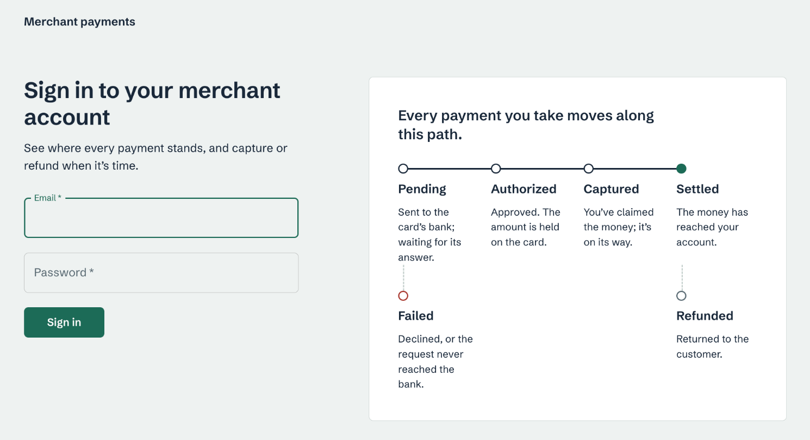
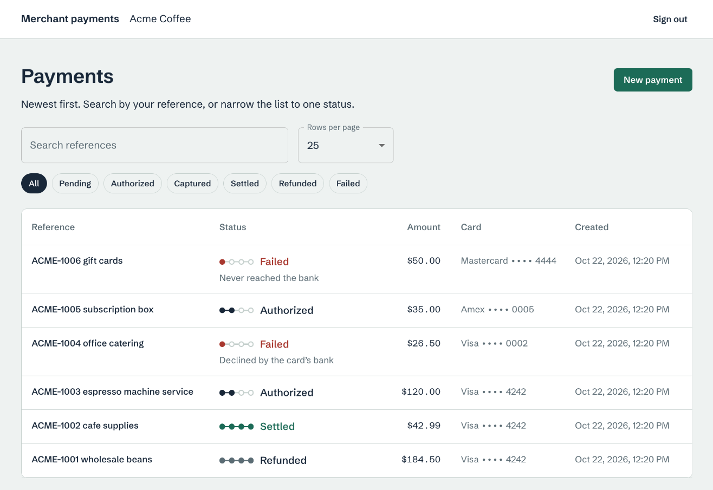
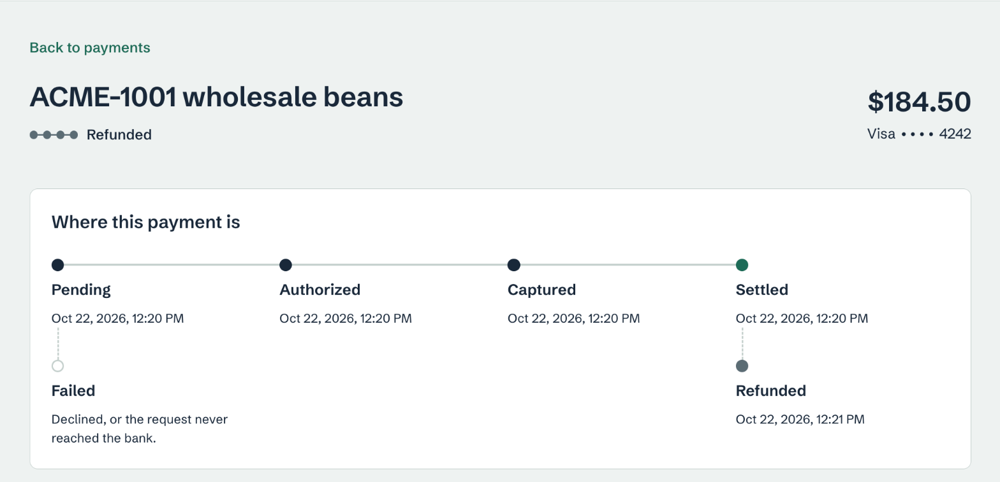
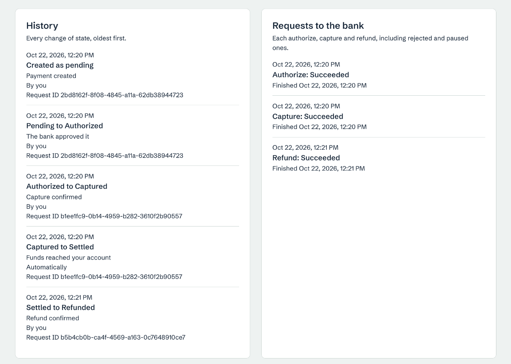
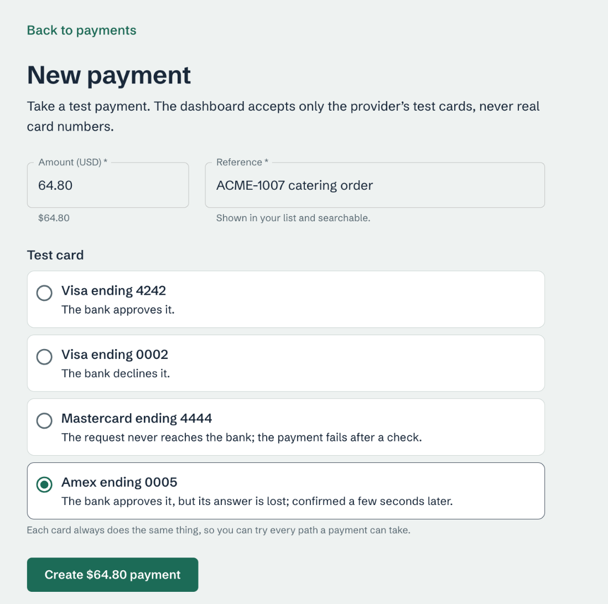
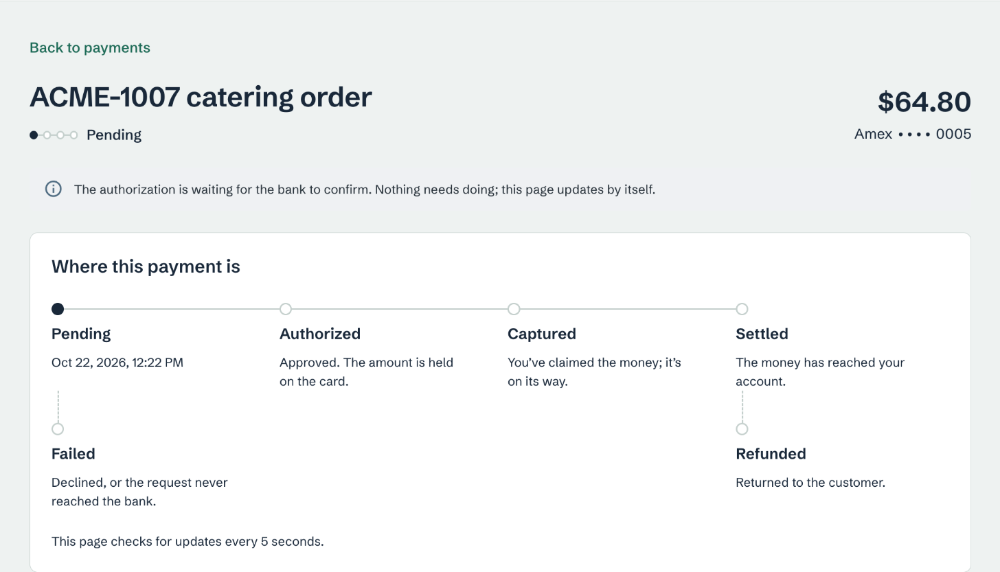
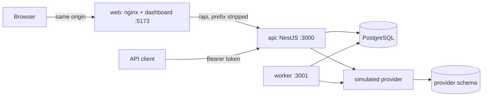
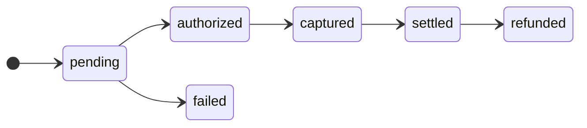

# Merchant Payment Processing Platform

A payment platform for merchants to create, capture, settle and refund card payments, with a REST API, a background worker and a web dashboard.

The focus is reliability. Payments stay correct when the provider times out, a response is lost, a request is retried or a process stops partway through: every action is idempotent, every state change is audited, and anything that can't be resolved automatically is flagged for review instead of retried forever. The scope is deliberately narrow and deep: a focused, production-minded subset rather than a broad feature set.

Everything runs locally with one command. A simulated payment provider reproduces approvals, declines, timeouts and lost responses, so no external account is needed.

**Key features**

- Idempotent create, capture and refund: retries and double clicks never charge twice
- A background worker that confirms settlement and recovers uncertain provider outcomes, with retries, backoff and a dead-letter state
- A complete audit trail: who changed each payment, when, why, and from which request
- JSON logs, Prometheus metrics, health checks, and a request ID and trace that follow a payment from the API into the worker
- A dashboard that survives reloads and lost responses without losing or repeating an action

## Contents

- [For reviewers](#for-reviewers)
- [Functional requirements](#functional-requirements)
- [Dashboard](#dashboard)
- [Tech stack](#tech-stack)
- [Architectural overview](#architectural-overview)
- [Architectural decisions](#architectural-decisions)
- [Operational thinking](#operational-thinking)
- [Tradeoffs made](#tradeoffs-made)
- [Setup instructions](#setup-instructions)
- [Project structure](#project-structure)
- [Assumptions](#assumptions)
- [Usage](#usage)
- [Operations](#operations)
- [Testing](#testing)
- [Production considerations](#production-considerations)
- [Areas for future improvement](#areas-for-future-improvement)
- [Documentation](#documentation)

## For reviewers

**Full documentation (PDF):** [Payment_Processing_Platform_Documentation.pdf](Payment_Processing_Platform_Documentation.pdf). Sections 2 to 7 are the six documentation deliverables, in the brief's order; section 8 answers the rest of the brief item by item (evaluation criteria, functional requirements, observability and operational requirements, technical expectations).

The six documentation deliverables, each under its own heading in this README:

| Deliverable | Summary |
|---|---|
| [Setup instructions](#setup-instructions) | One command with Docker Compose; sign-in details, test cards and how to run the tests |
| [Architectural overview](#architectural-overview) | An API, a worker and a dashboard around one PostgreSQL database, with a simulated provider; diagram and components |
| [Tradeoffs made](#tradeoffs-made) | What was chosen and what was given up |
| [Assumptions](#assumptions) | Decisions where the brief was open: currency, amounts, refunds, settlement, provider guarantees |
| [Production considerations](#production-considerations) | Known limitations, and what to ship instead of each local piece |
| [Areas for future improvement](#areas-for-future-improvement) | Prioritized next steps |

What the brief evaluates, and where to look in this README:

| Criterion | Where to look |
|---|---|
| System design | [Architectural overview](#architectural-overview), especially [How a payment request is processed](#how-a-payment-request-is-processed); every failure case and its handling in [`design_doc.md` §6.1](design_doc.md#61-failure-modes) |
| Code quality | [Engineering standards](#engineering-standards), [Project structure](#project-structure), [Testing](#testing) |
| Architectural decisions | [Architectural decisions](#architectural-decisions); each technology choice with its reason and cost in [`design_doc.md` §2.2](design_doc.md#22-technology-decisions) |
| Operational thinking | [Operational thinking](#operational-thinking), [Operations](#operations) |
| Engineering tradeoffs | [Tradeoffs made](#tradeoffs-made), [Production considerations](#production-considerations) |

The operational requirements, and where each is covered:

| Topic | Covered in |
|---|---|
| Observability: structured logs, correlation ID across API and worker, no PAN or CVV in logs, RED and business metrics, queue depth, lag and retries, tracing adoption | [Operational thinking](#operational-thinking), [Operations](#operations) |
| Reliability: idempotent create, capture and refund, retries with backoff, dead-letter handling | [Operational thinking](#operational-thinking), [Background work and failure handling](#background-work-and-failure-handling) |
| Audit trail of state transitions; health and readiness endpoints | [Operational thinking](#operational-thinking), [Service endpoints](#service-endpoints) |
| Authentication: how the token is validated and how a login expires | [Authentication](#authentication) |
| Repository hygiene | Public repository; no secrets or `.env` committed (only `.env.example`, with development-only values); a fresh clone runs by following [Setup instructions](#setup-instructions) alone |

Deeper detail is in [`design_doc.md`](design_doc.md) (decisions, failure analysis, security, scalability) and [`project_spec.md`](project_spec.md) (contracts).

## Functional requirements

| Requirement | How it is met |
|---|---|
| Log in to a merchant account | `POST /auth/login` for the dashboard (HttpOnly cookie), `POST /auth/token` for API clients (Bearer token) |
| Authenticate requests; expire logins | Signed JWT plus a server-side session, checked on every request; 8-hour expiry; logout revokes the session |
| Create a payment | `POST /payments`, idempotent through the `Idempotency-Key` header |
| Retrieve payment details | `GET /payments/{id}`, including state history and every request sent to the provider |
| Capture a payment | `POST /payments/{id}/capture` |
| Refund a payment | `POST /payments/{id}/refund` |
| List and search payments | `GET /payments` with status filter, reference search and cursor pagination |
| Payment lifecycle | `pending → authorized → captured → settled`, with `failed` and `refunded`; any other move is rejected |
| Asynchronous workflow | A worker that confirms settlement and recovers uncertain provider outcomes, with retries and a dead-letter state |
| Dashboard: log in, view, filter and search, details and statuses | A React dashboard, which also creates, captures and refunds payments |

## Dashboard

The merchant dashboard: payments at a glance, each payment's full history, and actions that stay safe across reloads and lost responses.

<table>
  <tr>
    <td width="50%"><br><sub><b>Sign in.</b> The lifecycle every payment follows, explained next to the form.</sub></td>
    <td width="50%"><br><sub><b>Payments.</b> Status filters, reference search and pages; each row shows how far the payment has got.</sub></td>
  </tr>
  <tr>
    <td width="50%"><br><sub><b>Payment details.</b> Where the payment is, and when it reached each stage.</sub></td>
    <td width="50%"><br><sub><b>History.</b> Every state change with who, why and the request ID, and every request sent to the provider.</sub></td>
  </tr>
  <tr>
    <td width="50%"><br><sub><b>New payment.</b> Four test cards, one for each path a payment can take.</sub></td>
    <td width="50%"><br><sub><b>Recovery in progress.</b> The provider's answer was lost; the worker confirms the outcome and the page updates by itself.</sub></td>
  </tr>
</table>

## Tech stack

| Layer | Technology |
|---|---|
| Language and runtime | TypeScript (strict), Node.js 24 LTS, npm workspaces |
| API | NestJS 11 |
| Database, queue and audit log | PostgreSQL 18 with `pg` and versioned SQL migrations |
| Background worker | Node.js, claiming jobs from PostgreSQL |
| Dashboard | React 19, MUI 9, React Router, Vite; served by nginx in Docker |
| Observability | Pino (JSON logs), Prometheus client (metrics), W3C Trace Context |
| Testing | Jest, Supertest, Ajv (OpenAPI contract checks), Vitest |
| Packaging | Docker multi-stage build, Docker Compose |

### Engineering standards

How the codebase handles each area of technical quality:

| Area | Approach |
|---|---|
| Architecture and code organization | Three apps (API, worker, dashboard) over shared packages; every lifecycle rule in `packages/payments`; SQL only in `packages/db` |
| API design | REST resources, one error envelope, idempotency keys on every mutation, cursor pagination, an OpenAPI 3.1 document checked by tests |
| Frontend quality | Loading, empty and error states; works at phone width; behaviour in small framework-free controllers with unit tests |
| Scalability | Stateless API; workers scale out safely with `SKIP LOCKED`; indexed search and keyset pagination |
| Security awareness | Argon2id passwords, HttpOnly cookie with CSRF token, login throttling, tenant isolation, provider tokens only (no card data), log redaction |
| Operational maturity | Health and readiness checks, metrics, structured logs, idempotency, retries with a dead-letter state, graceful shutdown |
| Testing strategy | Integration tests on real PostgreSQL, plus contract, concurrency, fault-injection and crash-recovery tests ([Testing](#testing)) |
| Maintainability | Strict TypeScript, lint and formatting enforced, small modules, decisions and contracts written down |
| Observability and logging | See [Operational thinking](#operational-thinking) |

## Architectural overview

### Architecture



| Component | Responsibility |
|---|---|
| `apps/api` | Authentication, validation, payment endpoints, OpenAPI, health and metrics |
| `apps/worker` | Background jobs: recovery of uncertain provider outcomes, settlement confirmation |
| `apps/web` | The merchant dashboard |
| `packages/payments` | Every lifecycle rule; the API and the worker only call it |
| `packages/db` | SQL, migrations and seeds |
| `packages/provider` | The simulated provider, with its own schema and transactions, like an external system |
| `packages/observability` | Logging with redaction, metrics, request and trace context |

### How a payment request is processed

Every create, capture and refund follows the same three steps:

1. **Reserve.** One short transaction records the operation and its recovery job (and, for a new payment, the payment and its first audit row), keyed by the client's `Idempotency-Key`. A capture or refund locks the payment row first, so two concurrent requests can't both go ahead.
2. **Call the provider,** with no database lock held. A slow provider never blocks other payments.
3. **Finalize.** A second transaction writes the outcome, but only if this process still owns the job and the payment hasn't changed (compare-and-set on its version).

If the provider times out, the payment keeps its state, the API answers `202 Accepted`, and the worker finds out what really happened. Repeating a request with the same key returns the stored response instead of acting again.

### Authentication

- **Sign-in:** `POST /auth/login` (dashboard) or `POST /auth/token` (API clients) checks the Argon2id password hash, creates a session row and issues a JWT signed with HS256, carrying the merchant ID, session ID, issuer, audience and expiry.
- **Transport:** the dashboard receives the token in an HttpOnly cookie and sends a CSRF token with every change; API clients send it as `Authorization: Bearer`.
- **Validation on every request:** signature, algorithm, issuer, audience and expiry are checked, then the session row must still be active and belong to that merchant.
- **Expiry:** a login lasts 8 hours (`SESSION_TTL_SECONDS`) and ends immediately on sign-out, which revokes the session. Failed sign-ins are throttled per email and per IP address.

### Payment lifecycle



Captures and refunds are for the full amount. Any other move is rejected with `409 INVALID_STATE_TRANSITION`.

### Background work and failure handling

The worker claims due jobs with `SELECT … FOR UPDATE SKIP LOCKED` and holds each one under a lease with a generation number. Two workers never claim the same job at once. If a worker stalls and its lease expires, another worker takes the job over, and the stalled worker's late result is discarded by the generation check.

- **Recovery** asks the provider for the outcome of an uncertain action. A capture or refund the provider never received is re-sent; an authorization it never received fails the payment and is not retried.
- **Settlement** confirms that captured funds are available, about ten seconds after capture.
- **Retries:** a timeout or an unreachable provider is retried three times with backoff (about 2, 4 and 8 seconds, with jitter).
- **Dead letter:** when retries run out, or the work is still unresolved after 30 minutes, the job is paused: a create, capture or refund becomes `needs_review`, and a settlement is flagged for review. Paused work stays visible in the dashboard and in the `jobs_paused` metric, and blocks other actions on that payment until someone resolves it.

## Architectural decisions

- **PostgreSQL is the job queue.** A job is committed in the same transaction as the payment change that needs it, so accepted work can't be lost between a commit and an enqueue.
- **Every mutation is reserve, call, finalize.** The provider is called with no database lock held, and the outcome is written only if the caller still owns the job and the payment hasn't changed.
- **The worker owns uncertainty.** Anything the API can't confirm becomes a job that looks up the real outcome, so no request has to wait for a slow provider.
- **One place for business rules.** The API and the worker both call `packages/payments`; neither implements lifecycle logic of its own.
- **Sessions are server-side.** A signed token alone can't be revoked; a session row can, so logout takes effect immediately.

## Operational thinking

Each observability and operational requirement of the brief, and how it is met:

| Requirement | How it is met |
|---|---|
| Structured logs | JSON lines (Pino), each with a named event |
| Correlation ID across the API and the async workflow | The request ID is stored on operations and jobs, and the worker logs under it |
| Deliberate log levels | `info` for state changes, `warn` for retries and timeouts, `error` for dead-lettered work, `debug` for routine polling |
| No sensitive data in logs (no PAN or CVV) | Card numbers and CVVs are never accepted, only provider tokens; key-based redaction of passwords, tokens and secrets at any depth; request and response bodies never logged |
| Request rate, errors, latency | `http_requests_total`, `http_request_duration_seconds` per route |
| Business metrics by state | `payment_transitions_total`, `payments_by_state` |
| Queue depth, lag, retries and failures | `jobs_due`, `jobs_lag_seconds`, `job_runs_total`, `jobs_paused` |
| Trace across the API and async work | W3C `traceparent` stored on the job and continued by the worker; trace and span IDs in every log line |
| Adopting distributed tracing | Add the OpenTelemetry SDK and a collector (for example with Tempo or Jaeger); the trace context already propagated through requests and jobs becomes the parent of the new spans |
| Health and readiness | `/health` and `/ready` on the API and the worker |
| Audit trail of state changes | One row per transition: who, when, from, to, why, and the originating request |
| Consistent errors | One error envelope with a code, a message and the request ID |
| Idempotent create, capture, refund | `Idempotency-Key` with the stored response replayed on retry |
| Retries, timeouts, dead-letter | 5-second provider timeout; three retries with backoff; then `needs_review` |

## Tradeoffs made

| Chose | Gave up |
|---|---|
| PostgreSQL as the job queue | A dedicated broker's throughput and tooling; claiming and retries are implemented here |
| Reserve, call, finalize in separate transactions | The simplicity of one transaction |
| JWT plus a server-side session | Fully stateless authentication: one session lookup per request |
| Hand-written SQL | ORM conveniences such as generated queries |
| A simulated provider | A real provider integration |
| Full captures and refunds, USD only | Partial amounts and multiple currencies |
| Docker Compose for running locally | Production orchestration (see [Production considerations](#production-considerations)) |

## Setup instructions

### Prerequisites

- Docker with Docker Compose v2 (Docker Desktop includes both)
- Free local ports 5173, 3000, 3001, 5432 and 5433

Nothing else is needed: Node.js, builds, migrations and tests all run in containers.

### 1. Start the platform

```sh
git clone https://github.com/intimanjunath/Merchant-payment-processing-platform.git
cd Merchant-payment-processing-platform
cp .env.example .env
docker compose up --build
```

`.env.example` holds development-only values; your copy, `.env`, is ignored by git. The first build takes a few minutes. To check that everything is up, run `docker compose ps` in another terminal: `api` and `worker` should be `healthy` and `web` `running`.

### 2. Sign in

Open **http://localhost:5173** and sign in with one of the development accounts:

| Merchant | Email | Password |
|---|---|---|
| Acme Coffee | `merchant1@example.test` | `acme-coffee-dev` |
| Blue Bicycle Shop | `merchant2@example.test` | `blue-bicycle-dev` |

Each account starts with a few sample payments in different states.

### 3. Take a test payment

1. Click **New payment**, enter an amount and a reference, and pick a test card.
2. With **Visa ending 4242**, the payment opens as **Authorized**.
3. Click **Capture** and confirm. Within about 15 seconds the page shows **Settled**, without a reload.
4. Click **Refund** and confirm. The payment is **Refunded**, and its history lists every step.

The dashboard accepts only these test cards; real card numbers are rejected.

| Test card | Token (for the API) | What happens |
|---|---|---|
| Visa ending 4242 | `pm_card_visa` | Approved |
| Visa ending 0002 | `pm_card_declined` | Declined by the bank; the payment is **Failed** |
| Mastercard ending 4444 | `pm_timeout` | The request never reaches the bank; after about 10 seconds the worker marks it **Failed** |
| Amex ending 0005 | `pm_lost_response` | Approved, but the bank's answer is lost; after about 10 seconds the worker confirms it **Authorized** |

### Run the tests

```sh
docker compose run --rm dev npm ci          # install packages once, after a fresh clone
docker compose run --rm dev npm run check   # format, lint, type-check, build
docker compose run --rm dev npm test        # all backend and dashboard tests
```

What the tests cover, and the latest results, are under [Testing](#testing).

### Service endpoints

| Service | URL |
|---|---|
| Dashboard | http://localhost:5173 |
| API | http://localhost:3000 (also at http://localhost:5173/api) |
| API reference (OpenAPI 3.1) | http://localhost:3000/openapi.json |
| API health, readiness, metrics | http://localhost:3000/health, `/ready`, `/metrics` |
| Worker health, readiness, metrics | http://localhost:3001/health, `/ready`, `/metrics` |

### Startup order

1. `db`: PostgreSQL 18 (and `test-db`, used only by the automated tests).
2. `init`: applies migrations, creates the two development merchants and their sample payments, then exits (about 10 seconds).
3. `api` and `worker`, once `init` has succeeded.
4. `web`, once the API is ready.

Two sample payments are meant to end up refunded, which is only possible after the worker has settled them. To finish them, run the setup job again (safe to repeat):

```sh
docker compose run --rm init
```

### Stop and reset

```sh
docker compose down      # stop; data is kept
docker compose down -v   # stop and delete all data
```

If a port is already in use, set `WEB_HOST_PORT`, `API_HOST_PORT`, `WORKER_HOST_PORT`, `DB_HOST_PORT` or `TEST_DB_HOST_PORT` in `.env`. A different web port must also be added to `ALLOWED_ORIGINS`.

## Project structure

```text
apps/
  api/            NestJS API: auth, payment routes, OpenAPI, health, development seed
  worker/         Job runner: claim loop, recovery and settlement, health server
  web/            React dashboard, plus the nginx config used in Docker
packages/
  payments/       Lifecycle rules, reservation, finalization, recovery, settlement
  db/             Connection pool, SQL repositories, migrations, seeds
  provider/       Provider interface and the simulated provider
  observability/  Logger, redaction, metrics, request and trace context
  config/         Environment parsing shared by the API and the worker
tests/            Integration tests against PostgreSQL, and their helpers
Dockerfile        One build with two targets: app (API, worker, init) and web (nginx)
compose.yaml      Local stack: databases, init job, API, worker, dashboard
```

## Assumptions

Decisions made where the brief was open ([details](design_doc.md#13-assumptions)):

- USD only, in integer cents, from $0.01 to $1,000,000.00.
- Full captures and refunds; refunds only after settlement.
- Settlement means provider-confirmed funds, simulated ten seconds after capture.
- An authorization the provider never received fails; it isn't retried later.
- One user per merchant account.
- The provider deduplicates requests by key, answers lookups, and never lets a "not received" request succeed later.

## Usage

### Failure scenarios in the dashboard

Signed in as Acme Coffee, try the cards that misbehave:

1. **Amex ending 0005:** the bank approves the payment but its answer is lost. The page waits about five seconds, opens the payment as **Pending** ("waiting for the bank to confirm"), and the worker confirms it as **Authorized** a few seconds later. Reload at any point: nothing is lost and nothing is charged twice.
2. **Mastercard ending 4444:** the request never reaches the bank. The payment ends **Failed** with "never reached the bank".
3. **Visa ending 0002:** declined immediately.
4. **Reload during a capture:** capture an Amex payment and reload straight away. The capture resumes with the same request and completes once.

Sign in as Blue Bicycle Shop in another browser profile: each merchant sees only their own payments.

### API

API clients get a Bearer token (browsers use an HttpOnly cookie plus a CSRF token). The commands below need only `curl` and `sed`:

```sh
API=http://localhost:3000
TOKEN=$(curl -s -X POST $API/auth/token \
  -H 'Content-Type: application/json' \
  -d '{"email":"merchant1@example.test","password":"acme-coffee-dev"}' \
  | sed -E 's/.*"accessToken":"([^"]+)".*/\1/')

# Create a payment. The Idempotency-Key makes retries safe.
KEY=readme-$(date +%s)
curl -s -w '\n' -X POST $API/payments \
  -H "Authorization: Bearer $TOKEN" -H "Idempotency-Key: $KEY" \
  -H 'Content-Type: application/json' \
  -d '{"amount":2500,"reference":"order-1001","paymentMethod":"pm_card_visa"}'

# The same request again returns the saved response: same payment, no second charge.
curl -s -w '\n' -X POST $API/payments \
  -H "Authorization: Bearer $TOKEN" -H "Idempotency-Key: $KEY" \
  -H 'Content-Type: application/json' \
  -d '{"amount":2500,"reference":"order-1001","paymentMethod":"pm_card_visa"}'

# Search, then capture (each mutation gets its own key).
curl -s -w '\n' "$API/payments?q=order-1001" -H "Authorization: Bearer $TOKEN"
PAYMENT=$(curl -s "$API/payments?q=order-1001&limit=1" -H "Authorization: Bearer $TOKEN" \
  | sed -E 's/.*"items":\[\{"id":"([^"]+)".*/\1/')
curl -s -w '\n' -X POST $API/payments/$PAYMENT/capture \
  -H "Authorization: Bearer $TOKEN" -H "Idempotency-Key: $KEY-capture"
curl -s -w '\n' $API/payments/$PAYMENT -H "Authorization: Bearer $TOKEN"
```

Amounts are integer cents in USD. The four test tokens are `pm_card_visa` (approved), `pm_card_declined` (declined), `pm_timeout` (never reaches the provider) and `pm_lost_response` (approved, answer lost). Anything that looks like a card number is rejected. The full API is described at `/openapi.json`.

## Operations

**Logs** are JSON, one event per line, with `requestId` and `traceId` on everything a request causes, including the worker's later jobs. Secrets, tokens and payment-method tokens are redacted by key at any depth; request and response bodies are never logged.

```sh
docker compose logs -f api worker
# Everything one request caused, in the API and the worker:
docker compose logs --no-log-prefix api worker | grep '<requestId>'
```

Each response carries its request ID in `X-Request-Id`, and the dashboard's details page shows it for every change of state. The worker continues the request's trace (same `traceId`, new span), so a capture and its settlement read as one story.

**Metrics** are in Prometheus text format at `/metrics` on both services:

```sh
curl -s localhost:3000/metrics | grep -E '^(http_requests_total|payment_transitions_total|provider_requests_total)'
curl -s localhost:3001/metrics | grep -E '^(payments_by_state|jobs_due|jobs_lag_seconds|jobs_paused|job_runs_total)'
```

| Signal | Metrics |
|---|---|
| Request rate, errors, latency | `http_requests_total`, `http_request_duration_seconds` |
| Payments by outcome and state | `payment_transitions_total`, `payments_by_state` |
| Provider calls | `provider_requests_total`, `provider_request_duration_seconds` |
| Queue depth, lag, retries, failures | `jobs_due`, `jobs_lag_seconds`, `job_runs_total` |
| Dead-letter backlog | `jobs_paused`, `operations_unresolved_oldest_age_seconds` |

Labels never contain payment or merchant IDs.

**Paused work** (the dead-letter queue):

```sh
docker compose exec db psql -U payments -d payments -c \
  "SELECT j.type, j.paused_reason, j.last_error, j.payment_id, o.action
     FROM jobs j LEFT JOIN operations o ON o.id = j.operation_id
    WHERE j.status = 'paused' ORDER BY j.updated_at"
```

There is no resume command yet; resolving paused work is a deliberate, manual decision.

## Testing

```sh
docker compose run --rm dev npm ci          # install packages once, after a fresh clone
docker compose run --rm dev npm run check   # format, lint, type-check, build
docker compose run --rm dev npm test        # Jest (API, worker, packages), then Vitest (dashboard)
```

**Latest results** (2026-10-22, commit `7c8c723`): `check` passes; Jest 34 suites, 456 tests passed; Vitest 9 files, 94 tests passed.

Integration tests run against real PostgreSQL, not mocks, because the correctness guarantees come from constraints, row locks, `SKIP LOCKED` and transaction boundaries. They use a separate `test-db` container with durability turned off (`fsync`, `synchronous_commit`, `full_page_writes`) and data in memory: faster runs, identical locking behaviour. Those settings are for disposable test data only.

| Test type | Covers |
|---|---|
| Unit | State machine, request hashing, cursor signing, retry delays, log redaction, configuration |
| Integration | API and worker flows end to end, every test card, authentication expiry, revocation, CSRF, throttling, tenant isolation |
| Contract | API responses validated against the OpenAPI document; every route documented |
| Concurrency | Two captures at once produce one provider call; two workers never claim the same job; same-key creates produce one payment |
| Fault injection | Provider timeout before and after the effect, lost response, provider unavailable, retry exhaustion |
| Crash recovery | Provider succeeds and the application stops before saving: recovered exactly once; a stale lease owner can't overwrite the new owner |
| Frontend | Session, list paging, details polling and pending-action rules (Vitest) |
| Smoke | Fresh clone, `docker compose up --build`, healthy services |

Not automated yet: browser end-to-end tests, component tests, load tests and coverage reporting.

<details>
<summary>Local development commands</summary>

All commands run in the `dev` container, so the host's Node version doesn't matter.

```sh
docker compose run --rm dev npm ci
docker compose run --rm dev npm run db:migrate
docker compose run --rm dev npm run db:seed          # the two merchants
docker compose run --rm dev npm run seed:payments    # their payments
```

Dashboard with hot reload: stop the `web` and `api` containers, then run the API and the Vite dev server together on port 5173.

```sh
docker compose stop web api
docker compose run --rm -p 5173:5173 dev sh -c \
  "npm run build && (node apps/api/dist/main.js &) && npm run dev --workspace @payments/web"
```

</details>

## Production considerations

### Known limitations

| Limitation | Effect | Resolved by |
|---|---|---|
| Plain HTTP (`COOKIE_SECURE=false`) | Local use only; the API refuses `NODE_ENV=production` without secure cookies | TLS (see the table below) |
| Shared per-IP login limit behind nginx (`TRUST_PROXY=false`) | All browser users count against one limit of 50 failures per 15 minutes; the per-email limit still applies | Trusted proxy configuration |
| Simulated provider | No real money movement | A real provider adapter |
| No resume tool for paused work | Resolving `needs_review` needs a manual decision | Operator tooling |
| Development seeds and secrets in `.env.example` | Not for any shared environment | A secrets manager |
| Dashboard bundle just over 500 kB (MUI) | Vite build warning | Route-level code splitting |

### What to ship

Before shipping, in this order: TLS and secrets management, a real provider verified against the assumptions above, a managed database with tested backups, and CI with alerting. The full list, with what runs today and what to choose instead ([details](design_doc.md#14-production-readiness)):

| Area | Now (local) | Ship |
|---|---|---|
| Transport | HTTP | TLS terminated at a load balancer; `COOKIE_SECURE=true`; `TRUST_PROXY` set to that load balancer |
| Secrets | `.env` file | A secrets manager (for example AWS Secrets Manager or HashiCorp Vault) with rotation |
| Runtime | Docker Compose | Kubernetes or Amazon ECS; at least two API and two worker replicas; health-gated rolling deploys |
| Database | One PostgreSQL container | Managed PostgreSQL (for example Amazon RDS or Cloud SQL) with high availability, point-in-time recovery and tested restores; PgBouncer |
| Migrations | Run by the `init` container at start | A separate, gated release step in the pipeline |
| Provider | Simulated provider | A real provider adapter (for example Stripe), verified against the assumptions above |
| Network | Every port bound to `127.0.0.1`, including metrics and health | Only the dashboard and API behind the load balancer; `/metrics`, `/health`, `/ready` and `/openapi.json` on the internal network only |
| Logs | stdout | Shipped to a log platform (for example Loki, Elasticsearch or Datadog) |
| Metrics and alerts | `/metrics` endpoints | Prometheus with Grafana; alerts on `jobs_paused` > 0, `jobs_lag_seconds`, provider timeouts, 5xx rate, stale worker heartbeat |
| Tracing | Trace IDs in logs | OpenTelemetry SDK and collector, with Tempo or Jaeger |
| Delivery | Checks run by hand | CI (for example GitHub Actions): `check`, both test suites, image build, image and dependency scanning (for example Trivy) |
| Data lifecycle | Everything retained | Retention jobs for completed jobs, sessions, login attempts and idempotency records |
| Capacity | Not load-tested | Load tests (for example k6) of listing, job claiming and connection pools |
| Operations | Paused work listed by SQL | Runbooks and a guarded resume tool; on-call ownership |

## Areas for future improvement

What I would do with more time, in priority order:

1. **CI pipeline** running the checks, both test suites and the image build on every change, so nothing merges unverified.
2. **A guarded resume tool for paused work,** so dead-lettered payments can be resolved without hand-written SQL.
3. **Automated browser end-to-end tests** (Playwright) for create, capture, settle and refund, and for the lost-response reload.
4. **Tests for the remaining crash points:** before reservation, before the provider call, and after the commit but before the response.
5. **A real provider adapter** (for example Stripe) behind the existing provider interface, and an OpenTelemetry tracing backend.
6. **Wider payment features:** partial captures and refunds, refunds before settlement, multiple currencies, outbound webhooks, API keys and staff roles.

## Documentation

| Document | Contents |
|---|---|
| [`Payment_Processing_Platform_Documentation.pdf`](Payment_Processing_Platform_Documentation.pdf) | The submission documentation in one PDF: requirements coverage, setup, architecture with diagrams, testing, tradeoffs, assumptions, production considerations, future improvements and screenshots |
| [`design_doc.md`](design_doc.md) | Architecture, decisions and tradeoffs, failure handling, security, scalability, testing strategy, assumptions, production readiness; [§1.2](design_doc.md#12-requirements-coverage) maps every requirement of the brief |
| [`project_spec.md`](project_spec.md) | Contracts: data flows, state machines, API, database schema, provider, metrics and log events, configuration, dashboard behaviour, deployment |
| [`Software_Engineer-Technical_Exercise-Payment_Processing_Platform.md`](Software_Engineer-Technical_Exercise-Payment_Processing_Platform.md) | The original brief |
