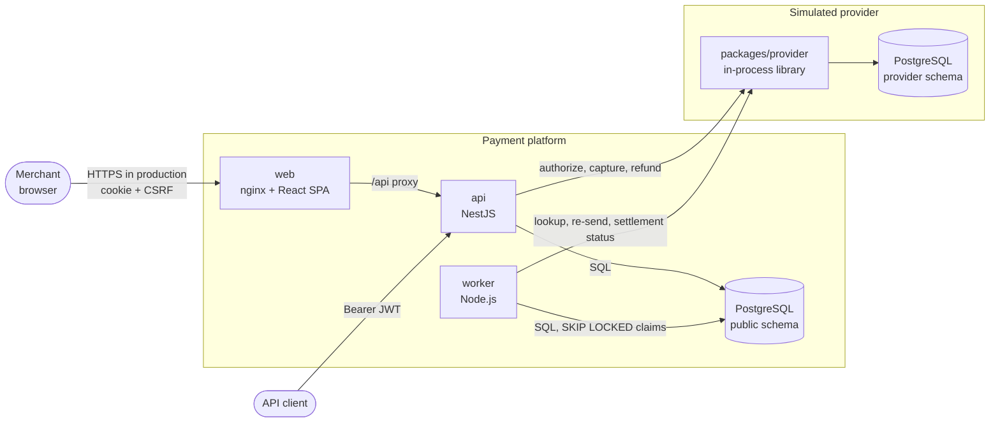
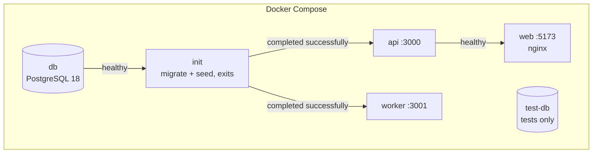
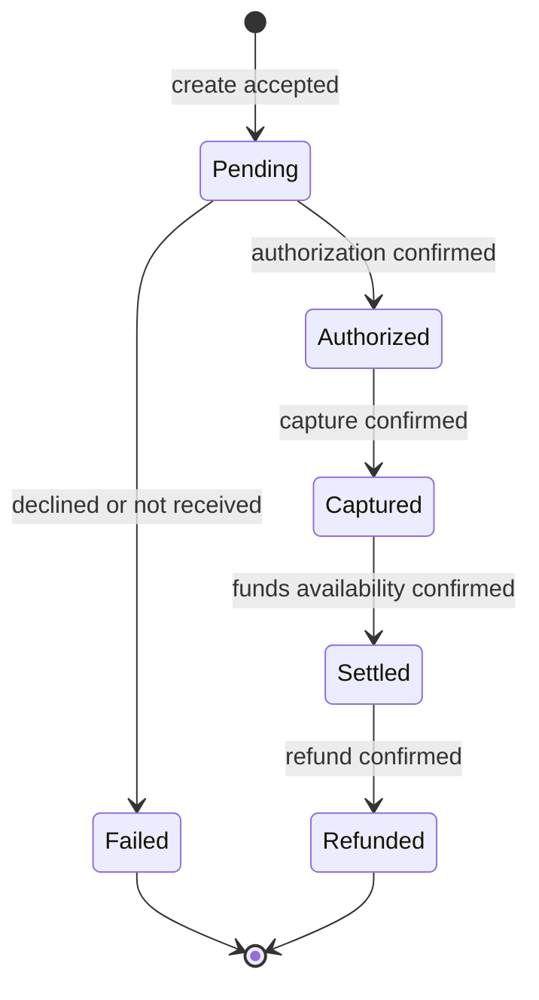
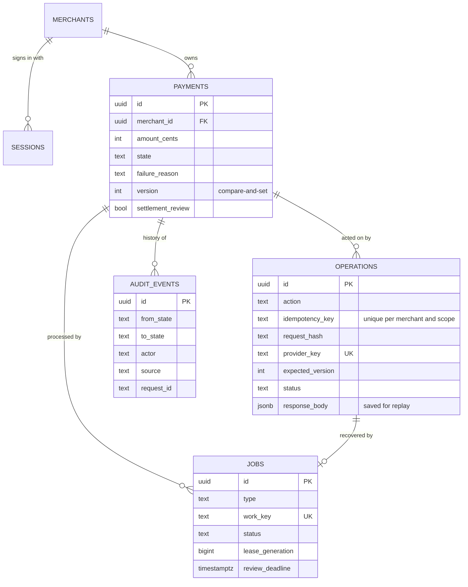

# Payment Processing Platform: Design

## 1. Overview

### 1.1 Scope

A merchant payment platform with an authenticated REST API, a web dashboard and a background worker. A merchant signs in, creates payments, captures them, sees them settle and refunds them. A simulated provider, driven by test payment-method tokens, produces approvals, declines, timeouts and lost responses deterministically, without external credentials.

The design prioritizes correctness under failure: idempotent mutations, no double charges under retries or concurrency, recovery of indeterminate provider outcomes, an append-only audit trail, and a visible dead-letter state for work that cannot be resolved automatically.

| In scope | Out of scope |
|---|---|
| Browser and API-client authentication | Customer checkout and card tokenization (provider-side) |
| Create, capture, full refund, details, list and search | Partial captures and refunds, cancellation, multiple currencies |
| Settlement confirmation and recovery workflows | Outbound webhooks, reconciliation reports |
| Idempotency, audit, logs, metrics, trace propagation, health checks | A deployed tracing backend, alerting |
| Local deployment with Docker Compose | TLS, production infrastructure |

### 1.2 Requirements coverage

Every requirement in the brief (`Software_Engineer-Technical_Exercise-Payment_Processing_Platform.md`) is met. The table states how, in one line each, and where the detail is. Exact contracts are in `project_spec.md` (its §9 maps them to the brief); setup and operation are in `README.md`.

**Functional (brief §3)**

| Requirement | How it is met | Section |
|---|---|---|
| Log in to a merchant account | `POST /auth/login` (browser cookie) and `POST /auth/token` (Bearer for API clients) | §4.1 |
| Validate each request; expire the login | Signed JWT plus a server-side session checked on every request; 8-hour expiry; logout revokes | §4.1 |
| Create, retrieve, capture, refund | REST endpoints, each mutation idempotent | §4.2, §5.2 |
| List and search | Status filter, reference substring search, cursor pagination | §4.2 |
| Lifecycle Pending → Authorized → Captured → Settled, with Failed and Refunded | One transition table; any other move is rejected | §3 |
| At least one asynchronous workflow | Two, run by the worker: settlement confirmation and recovery of uncertain provider outcomes | §7 |
| Dashboard: log in, view, filter and search, details and statuses | React dashboard; also creates, captures and refunds | §8 |

**Observability and operations (brief §4)**

| Requirement | How it is met | Section |
|---|---|---|
| Structured logs | JSON lines with a named event per line | §9.1 |
| Correlation ID across the API and the async workflow | Request ID stored on operations and jobs and logged by the worker | §9.1 |
| Deliberate log levels | info for transitions, warn for retries, error for dead-lettered work, debug for polling | §9.1 |
| No sensitive data in logs | Key-based redaction; bodies never logged; card data never accepted | §3.1, §9.1 |
| RED metrics | Request rate, errors and latency per route | §9.2 |
| Business metrics by state | Transition counters and a gauge per state | §9.2 |
| Queue depth, lag, retries and failures | `jobs_due`, `jobs_lag_seconds`, `job_runs_total`, `jobs_paused` | §9.2 |
| Trace across the API and async work | W3C trace context carried on the job and continued by the worker; adoption path for OpenTelemetry | §9.3 |
| Health and readiness endpoints | `/health` and `/ready` on the API and the worker | §9.4 |
| Audit trail of state transitions | One row per transition: who, when, from, to, why | §9.5 |
| Consistent errors | One error envelope and a fixed code table | §4.3 |
| Idempotent create, capture and refund | `Idempotency-Key` with stored responses | §5.2 |
| Retries, timeouts, dead-letter | 5 s timeout, 3 retries with backoff, then `needs_review` | §6, §7 |

**Engineering quality and documentation (brief §5–6)**

| Requirement | How it is met | Section |
|---|---|---|
| Architecture and code organization | Apps for each process; rules, data access, provider and observability in shared packages | §2 |
| API design | Consistent resources, status codes and errors; OpenAPI document checked by tests | §4 |
| Scalability | Stateless API, horizontally scalable worker, indexed queries | §11 |
| Security | Hashed passwords, session checks, CSRF, throttling, tenant isolation, no card data | §10 |
| Testing strategy | Unit, integration, contract, concurrency, fault-injection and crash-recovery tests | §12 |
| Setup instructions | One command with Docker Compose | README |
| Architecture overview; tradeoffs | Diagrams and a decision table | §2 |
| Assumptions; production considerations; future improvements | Dedicated sections | §13, §14, §15 |

## 2. Architecture

### 2.1 System context and containers



| Container | Responsibility | Does not |
|---|---|---|
| `web` | Dashboard SPA; nginx serves static assets and proxies `/api` to the API | Access the database or provider; decide lifecycle rules |
| `api` | Authentication, validation, idempotency, reservation, synchronous provider call, finalization, read endpoints | Run background polling |
| `worker` | Claims due jobs; recovers indeterminate outcomes; confirms settlement; publishes queue gauges | Serve merchant traffic |
| PostgreSQL | System of record, job queue and audit log | — |
| Provider | Deterministic fake with durable state in its own schema and its own transactions, so its effects survive application rollbacks as an external provider's would | — |

All lifecycle rules live in `packages/payments`; the API controllers and worker handlers only translate HTTP requests or jobs into calls on it. SQL lives only in `packages/db`.

### 2.2 Technology decisions

| Area | Choice | Rationale | Tradeoff |
|---|---|---|---|
| Language and runtime | TypeScript (strict), Node.js 24 LTS, npm workspaces | One language and type system across API, worker, dashboard and shared packages | Single-threaded runtime; CPU-heavy work would need workers |
| API framework | NestJS 11 | Modules, guards, pipes and DI give a consistent structure for auth and validation | More setup than Express |
| Persistence | PostgreSQL 18, `pg`, hand-written SQL, versioned migrations | Transactions, row locks, constraints and partial indexes carry the correctness guarantees; explicit SQL keeps lock and transaction boundaries visible | No ORM conveniences; queries are written and reviewed by hand |
| Job queue | `jobs` table, `SELECT … FOR UPDATE SKIP LOCKED`, leases with generations | No extra infrastructure; jobs commit atomically with the business rows that create them | Claiming, retries and lease expiry are implemented in-house; throughput bounded by the database |
| Authentication | HS256 JWT plus a server-side session row | Explicit expiry and immediate revocation on logout | One session lookup per request; not stateless |
| Provider | In-process fake with test tokens and fault injection | Reproducible success, decline, timeout and lost-response paths, including in tests | No real provider integration |
| Dashboard | React 19, MUI 9, React Router, Vite; framework-free controllers bound with `useSyncExternalStore` | Component library for tables and forms; business behaviour testable without a DOM | ~500 kB bundle (MUI) |
| Observability | Pino, Prometheus client (`@prometheus-io/client`), W3C Trace Context | Structured logs, standard metrics exposition, vendor-neutral trace propagation | No tracing backend deployed |
| Packaging | One multi-stage `Dockerfile` (targets `app`, `web`), Docker Compose | One build for all Node services; one command starts the stack | Compose is a local runtime, not a production orchestrator |

### 2.3 Repository layout

```text
.
├── apps/
│   ├── api/          # NestJS API: auth, payment routes, OpenAPI, health; development payment seed
│   ├── worker/       # Job runner: claim loop, recovery and settlement handlers, health server
│   └── web/          # React dashboard; nginx.conf for the container
├── packages/
│   ├── payments/     # Lifecycle rules, reservation, finalization, recovery, settlement, metrics
│   ├── db/           # Pool, transactions, SQL repositories, migrations, merchant seed
│   ├── provider/     # Provider contract and the durable fake
│   ├── observability/# Logger and redaction, request context, metrics registry, trace context
│   └── config/       # Environment parsing shared by API and worker
├── tests/
│   ├── integration/  # API, database, provider and worker tests against PostgreSQL
│   └── helpers/      # Test database, scratch databases, fixtures
├── Dockerfile        # Targets: app (API, worker, init) and web (nginx)
├── compose.yaml      # db, test-db, init, api, worker, web, dev tools
├── design_doc.md     # This document
├── project_spec.md   # Contracts: flows, API, schema, metrics, configuration
└── README.md         # Setup, usage, operations, test results
```

Unit tests sit next to the code they test; tests spanning components are in `tests/integration`.

### 2.4 Deployment



The `app` image (compiled packages plus the API's and worker's production dependencies, run as a non-root user) runs `init`, `api` and `worker` with different commands. The `web` image is nginx serving the built SPA: `/api/` is proxied to the API with the prefix stripped, other paths fall back to `index.html`. Health checks call `/ready`. The worker's stop grace period exceeds its drain timeout.

## 3. Payment lifecycle



- **Amounts:** USD, integer cents, 1 to 100,000,000. References are trimmed, 1–100 characters.
- **Allowed actions:** capture from Authorized, refund from Settled, full amount only. Any other action returns 409 `INVALID_STATE_TRANSITION`.
- **Rejections:** a rejected capture keeps Authorized; a rejected refund keeps Settled. The operation is finalized as rejected without a state transition.
- **Timeouts** never change payment state. Elapsed time alone never fails a payment.
- **Not received:** if the provider confirms it never received an authorization, the payment becomes Failed (`authorization_not_received`) and is never re-authorized. A capture or refund the provider never received is re-sent with the same provider key, which the provider deduplicates.
- **Settlement** means provider-confirmed funds availability (simulated ten seconds after capture), not a bank payout. The worker confirms it.
- **State vs. operation:** payment state is a confirmed outcome. Operation status (`reserved`, `awaiting_confirmation`, `needs_review`, `succeeded`, `rejected`) describes an action in progress.

### 3.1 Payment methods and PCI scope

The platform never receives card numbers or CVVs; tokenization belongs to the provider. `POST /payments` accepts a provider token in `paymentMethod`. Request validation rejects unknown properties, so a field such as `cardNumber` is refused without being stored, echoed or logged. Only the token, brand and last four digits are stored; responses expose brand and last four; logs never contain the token.

| Token | Provider behavior |
|---|---|
| `pm_card_visa` | Every call succeeds |
| `pm_card_declined` | Authorization declined; payment created as Failed |
| `pm_timeout` | Authorization never reaches the provider; API returns 202; recovery fails the payment (`authorization_not_received`) |
| `pm_lost_response` | The first call of each operation takes effect but its response is lost; API returns 202; recovery confirms the outcome without a second effect |

## 4. API and authentication

### 4.1 Authentication

Passwords are hashed with Argon2id. Login issues an HS256 JWT (merchant ID, session ID, issuer, audience, expiry; eight hours) backed by a `sessions` row. Every request verifies algorithm, signature, issuer, audience and expiry, then confirms the session is active and belongs to the token's merchant. Logout revokes the session, so a revoked token fails immediately.

| Client | Credential | CSRF protection |
|---|---|---|
| Browser | `POST /auth/login` sets the JWT in an HttpOnly, SameSite=Lax cookie (`Secure` in production) | Mutations require `X-CSRF-Token`, an HMAC of the session ID; `Origin`/`Referer`, when sent, must be in `ALLOWED_ORIGINS`; login itself is origin-checked |
| API client | `POST /auth/token` returns the JWT in the body; sent as `Authorization: Bearer` | Not required: browsers never attach this header, and no cross-origin access is enabled. When `Authorization` is present it is the only credential considered |

The dashboard calls the API on its own origin under `/api` (nginx in Compose, the Vite proxy in development), which keeps the cookie first-party and lets page routes such as `/payments/:id` survive a reload. Because the cookie is HttpOnly, the dashboard learns the session and a fresh CSRF token from `GET /auth/session` on page load.

**Login throttling.** Failed attempts are counted in PostgreSQL per normalized email and per client IP, so limits hold across API instances (defaults: 15-minute window, 5 per email, 50 per IP; configurable). Each attempt is counted atomically before the password check, so parallel guesses cannot all pass a read-then-write check; a successful login clears the email's count. Advisory locks taken in a fixed order (email, then IP) prevent deadlocks. Exceeding a limit returns 429 with `Retry-After`; credential errors are generic.

**Tenant isolation.** Every query is scoped by the merchant from the verified session. Another merchant's resource returns 404, indistinguishable from a missing one.

### 4.2 Endpoints

| Endpoint | Behavior |
|---|---|
| `POST /auth/login` | Verify credentials; set session cookie; return merchant, expiry and CSRF token |
| `POST /auth/token` | Verify credentials; return `{ accessToken, tokenType, expiresAt }`; no cookie |
| `GET /auth/session` | Current merchant, expiry and CSRF token |
| `POST /auth/logout` | Revoke the session; clear the cookie; 204 |
| `POST /payments` | `{ amount, reference, paymentMethod }` plus `Idempotency-Key`; 201 when authorized or declined, 202 when unresolved |
| `GET /payments/{id}` | Payment, unresolved operation, operation history and transition history |
| `GET /payments?status=&q=&limit=&cursor=` | Status filter, reference substring search, keyset pagination (default 25, max 100) |
| `POST /payments/{id}/capture` | `Idempotency-Key`; 200 confirmed, 422 rejected by provider, 202 unresolved |
| `POST /payments/{id}/refund` | Same rules; allowed only from Settled |

Create returns 201 for a decline because a payment resource now exists, in state Failed. Capture and refund act on an existing payment, so a provider rejection returns 422 and the payment keeps its state. Lists return `{ items, nextCursor }` ordered by `(created_at DESC, id DESC)`; cursors are HMAC-signed and bound to the merchant and filters. The API serves a hand-written OpenAPI 3.1 document at `/openapi.json`; tests fail if a route is undocumented, documented but missing, or a response does not match its schema.

### 4.3 Error model

Errors use one envelope, `{ "error": { "code", "message", "requestId", "details?" } }`. Messages never include submitted values.

| HTTP | Code | When |
|---|---|---|
| 400 | `VALIDATION_ERROR` | Invalid body, query, cursor, idempotency key or token |
| 413 / 415 | `VALIDATION_ERROR` | Body too large; unsupported charset or `Content-Encoding` |
| 401 | `INVALID_CREDENTIALS` | Login failed (generic message) |
| 401 | `UNAUTHENTICATED` | Missing, invalid, expired or revoked token |
| 403 | `CSRF_REJECTED` | Cookie mutation without a valid CSRF token, or a disallowed Origin/Referer |
| 404 | `NOT_FOUND` | Missing, or owned by another merchant |
| 409 | `INVALID_STATE_TRANSITION` | Action not allowed from the current state |
| 409 | `OPERATION_IN_PROGRESS` | Another mutation on the payment is unresolved, including one paused for review |
| 409 | `IDEMPOTENCY_CONFLICT` | Same key reused with different input |
| 422 | `PROVIDER_REJECTED` | Provider rejected a capture or refund; state unchanged |
| 429 | `RATE_LIMITED` | Login throttle exceeded; `Retry-After` set |
| 500 | `INTERNAL_ERROR` | Unexpected failure; no internals exposed |
| 503 | `SERVICE_UNAVAILABLE` | The database cannot durably accept the work |

## 5. Data model and idempotency

### 5.1 Entities



`login_attempts` (throttle counters) and the provider's `provider.charges` and `provider.requests` tables complete the schema; full DDL is in spec §5.

Operations and jobs carry the initiating request ID and `traceparent`. A settlement job inherits both from the capture that scheduled it, so a payment's history can be followed from the API request to settlement.

### 5.2 Idempotency

Create, capture and refund require an `Idempotency-Key` (1–128 printable ASCII characters). Keys are unique per `(merchant, scope, key)`, where the scope is `create` or the action plus payment ID. The request is hashed after validation and normalization, so property order does not matter.

| Request | Response |
|---|---|
| Same key, same input, operation finished | The saved status and body (replay) |
| Same key, same input, operation unresolved | 202 with current state |
| Same key, different input | 409 `IDEMPOTENCY_CONFLICT` |

Validation, authorization and state errors are not stored, because no operation was reserved; retrying them with the same key is safe. Idempotency records are retained for the life of this system.

### 5.3 Concurrency control

| Mechanism | Guarantee |
|---|---|
| Payment row lock (`SELECT … FOR UPDATE`) during capture/refund reservation, with idempotency, unresolved-operation and state checks under the lock | Two concurrent captures cannot both see Authorized and both call the provider |
| Partial unique index: one unresolved operation per payment | A second mutation returns 409 `OPERATION_IN_PROGRESS` |
| Unique `(merchant, scope, key)` index | Concurrent same-key creates produce one payment |
| `payments.version` compare-and-set at finalization | A finalization cannot apply to a payment that changed unexpectedly |
| Lock order payment → operation → job in every multi-row transaction | No lock-order deadlocks |
| No lock held across a provider call | A slow provider cannot block other transactions |

## 6. Mutation execution and recovery

```mermaid
sequenceDiagram
    autonumber
    participant C as Client
    participant A as API
    participant DB as PostgreSQL
    participant P as Provider
    participant W as Worker
    C->>A: POST /payments/{id}/capture (Idempotency-Key)
    A->>DB: TX1: lock payment, check key/state, insert operation + leased job, COMMIT
    A->>P: capture(providerKey)
    alt definitive answer
        P-->>A: succeeded / rejected
        A->>DB: TX2: lock payment → operation → job, check generation + version, write state, audit, saved response
        A-->>C: 200 / 422
    else timeout or provider unavailable
        P--xA: no answer
        A->>DB: operation awaiting_confirmation, job queued
        A-->>C: 202 (unresolved)
        W->>DB: claim job (SKIP LOCKED, generation + 1)
        W->>P: lookup(providerKey); re-send if not received
        W->>DB: finalize as TX2, or retry with backoff, or pause (needs_review)
    end
```

1. **Reserve (TX1).** One short transaction writes the operation, its recovery job (already leased to the API), and for a create the payment and its first audit row. It commits before the provider is contacted.
2. **Call the provider** with the operation's provider key, holding no locks. The provider deduplicates by key and stores effects in its own transactions.
3. **Finalize (TX2)** on a definitive answer: lock payment, operation and job in order, verify the job's lease generation and the payment's version, then commit state, failure reason, operation result, saved response, audit row, job completion and (after a capture) the settlement job together.
4. **On timeout or unavailability**, mark the operation `awaiting_confirmation` and queue its job for the worker.
5. **Recover.** The worker looks up the provider key. A confirmed outcome is finalized. "Not received" fails a create (`authorization_not_received`) or re-sends a capture or refund with the same key.

In the provider, lookup and authorize both write one row per provider key with `INSERT … ON CONFLICT DO NOTHING`, so a lookup that records "not received" and a late-arriving authorization cannot both succeed. A real provider must offer an equivalent guarantee (§14).

### 6.1 Failure modes

| Failure | Result | Mechanism | Automated test |
|---|---|---|---|
| Process dies after the provider applied the effect, before TX2 | Recovered exactly once | Job lease expires; worker looks up the key and finalizes | Yes |
| Lease owner stalls; another worker takes the job; the first returns late | First owner's result discarded | Generation check on every write | Yes |
| Provider times out with no effect (`pm_timeout`) | Create fails as not received; late original call rejected | Atomic lookup-and-mark | Yes |
| Provider times out after the effect (`pm_lost_response`) | Outcome confirmed by recovery, no second effect | Lookup by provider key | Yes |
| Two concurrent captures with different keys | One provider call; the other gets 409 | Row lock and partial unique index | Yes |
| Process dies before TX1 commits | Nothing persisted; client retries | Transaction atomicity | By design |
| Process dies after TX1, before the provider call | Recovery finds "not received": create fails, capture/refund re-sent | Leased job plus lookup | By design |
| Process dies after TX2, before the HTTP response | Client retry replays the saved response | Idempotency record | By design |
| Provider repeatedly unavailable | Retried with backoff, then paused for review | Retry budget (§7) | Yes |
| Database unavailable | 503; readiness fails | Error mapping; `/ready` | Yes |

## 7. Background processing

The worker runs two kinds of jobs. Both are rows in the `jobs` table, created in the same transaction as the business change that needs them, so no accepted work can be lost between a commit and an enqueue.

| Job type | Created when | Each attempt | Finishes when |
|---|---|---|---|
| `operation_recovery` | Every create, capture and refund, at reservation, already leased to the API. The worker gets it when the API's provider call times out (queued) or the API stops (claimable once the lease expires) | Look up the provider key; re-send a capture or refund the provider never received | The operation is finalized (succeeded or rejected) |
| `settlement` | A capture is confirmed; due after the poll interval | Ask the provider whether the captured funds are available | The payment is Settled, or no longer Captured |

### 7.1 Claiming and leases

```mermaid
flowchart LR
    poll[Poll every 5 s] --> claim[Claim due jobs<br/>FOR UPDATE SKIP LOCKED<br/>lease 30 s, generation + 1]
    claim --> check[Re-check job identity]
    check --> renew[Renew lease]
    renew --> call[Call provider<br/>no locks held]
    call --> write[Write result in one transaction<br/>if generation unchanged]
    write --> poll
```

- **Claim:** due jobs (queued and due, or running with an expired lease) are selected with `FOR UPDATE SKIP LOCKED`, so concurrent workers never wait on, or take, the same job. A claim sets the lease owner and a 30-second expiry and increments the lease generation.
- **Capacity:** a worker claims only as many jobs as it has free slots (`WORKER_CONCURRENCY`, default 1), so a claimed job never waits locally while its lease runs out.
- **Lease:** renewed before every provider call. It must outlast one full attempt (lookup plus re-send), which configuration validation enforces.
- **Ownership:** every write compares the lease generation first. If another worker took the job over after the lease expired, the late result is discarded and counted as `lease_lost`.
- **Identity:** before acting, the job is re-read and must still name the same payment and operation; otherwise it raises `WorkMismatchError` and writes nothing.

### 7.2 Outcomes and retries

| Attempt outcome | Job | Retry budget | Metric result |
|---|---|---|---|
| Definitive provider answer, or "not received" for a create | Completed; operation finalized | — | `completed` |
| Ordinary wait (settlement not yet available) | Rescheduled after 5 s | Reset to 0 | `rescheduled` |
| Technical failure (timeout, provider unavailable) | Rescheduled after backoff | +1 | `retried` |
| Budget exhausted, or review deadline passed | Paused | — | `paused` |
| Lease taken over by another worker | Result discarded | — | `lease_lost` |
| Payment changed unexpectedly | Nothing written; reclaimed after the lease expires, paused at the review deadline if it persists | — | `version_conflict` |
| Unexpected error | Nothing written; reclaimed after the lease expires | — | `failed` |

| Policy | Value |
|---|---|
| Provider timeout | 5 s per call |
| Retry budget | 1 attempt plus up to 3 retries |
| Backoff | 2, 4, 8 s, ±20% jitter |
| Review deadline | 30 min from job creation |
| Settlement availability (fake) | 10 s after capture |
| Heartbeat | Every 10 s; `/health` stale after 30 s |
| Shutdown | Stop claiming; drain in-flight jobs for up to 15 s; anything unfinished is reclaimed after its lease expires |

A recovery attempt is one claim: the lookup plus any re-send it requires. A technical failure anywhere in it consumes one unit of budget, so a pattern of "not received, re-send, timeout" still stops after three retries.

### 7.3 Dead letter

When the retry budget or the review deadline is exhausted, the job is paused with a reason (`retries_exhausted` or `review_deadline_reached`):

- a create, capture or refund operation becomes **`needs_review`**, and the payment keeps its state;
- a settlement leaves the payment Captured with `settlement_review` set.

`needs_review` is the dead-letter state. Paused work stays with its full history, keeps blocking other mutations on the payment, is shown in the dashboard and is counted by `jobs_paused`. The README gives the query that lists it. Resolving it is a manual operator decision; there is no resume tooling yet (§15).

## 8. Dashboard

| Route | Purpose |
|---|---|
| `/sign-in` | Sign-in form and lifecycle explainer |
| `/` | Payment list: status filter, reference search, page size, older/newer pages |
| `/payments/new` | Create a payment with a test card |
| `/payments/:id` | Details: lifecycle with timestamps, history, operations, capture/refund |

Stateful behaviour lives in framework-free controllers (session, list, details, actions), tested with Vitest and bound to React with `useSyncExternalStore`.

- **Session.** The page-load check treats only a 401 as signed out; a network or server failure shows "can't reach the payment server" with a retry, so a valid session is never mistaken for a sign-out. Each adopted session has a generation; late responses can end only the session they started under. Sign-out clears the merchant's browser records.
- **List.** Status, search and page size are in the URL. Any filter change resets cursor history; older/newer navigation keeps the current rows while loading; a new filter shows placeholders. Only the latest request updates the view.
- **Return after sign-in.** After an explicit sign-out the next sign-in starts at the list; after an expired session, sign-in returns to the previous page only for the same merchant.
- **Details.** Polled every 5 seconds while something can change without the merchant (pending, captured, or an unresolved operation); paused while the tab is hidden; stopped once the payment is settled, refunded, failed or authorized with nothing in flight. A missing or foreign payment shows "not found".
- **Actions.** Capture is offered only when Authorized and refund only when Settled, with nothing in flight, behind a confirmation. Each action gets a new idempotency key, saved in merchant-scoped `sessionStorage` before the request; if it cannot be saved, the request is not sent. The record is cleared only on a definite answer (200, 201, 400, 404, 409, 422). After a 202 the action is re-sent once with the same key when the payment has no unresolved operation, collecting the stored outcome; after a network or server error it is re-sent only on the merchant's retry, always with the same key. A late answer never recreates a cleared record, overwrites a newer one, or updates a page that was left.

## 9. Observability

### 9.1 Logging

Pino writes JSON lines with `service`, `event`, `requestId`, `traceId` and, when known, payment, operation and job IDs. Levels: `info` for state transitions, `warn` for retries, timeouts and rejected requests, `error` for paused work, `debug` for routine polling. Redaction removes passwords, tokens, cookies, secrets and payment-method tokens by key at any depth, including inside serialized errors; request and response bodies are never logged. Event names are listed in spec §7.1.

### 9.2 Metrics

Both services expose Prometheus text at `/metrics`.

| Signal | Metrics |
|---|---|
| RED | `http_requests_total`, `http_request_duration_seconds` (method, route template, status class) |
| Business | `payment_transitions_total` (from/to state), `payments_by_state` |
| Provider | `provider_requests_total` (operation, outcome), `provider_request_duration_seconds` |
| Queue | `jobs_due` (depth), `jobs_lag_seconds`, `job_runs_total` (result), `jobs_paused` (dead-letter backlog), `operations_unresolved_oldest_age_seconds` |
| Liveness | `worker_heartbeat_timestamp_seconds` |

Labels are bounded: no payment IDs, merchant IDs or references. Database-wide gauges are computed by a single collector in the worker, so scaling the API does not double-count them. Process counters are per instance; the audit table remains authoritative.

### 9.3 Tracing

The API accepts or starts a W3C `traceparent` per request and stores it on the operation and job. The worker continues the stored trace (same trace ID, new span ID, the stored span recorded as `followsFromSpanId`). Trace and span IDs are in every log line. No exporter or tracing backend is deployed; adopting OpenTelemetry means adding its SDK and a collector, with the existing context as the parent.

### 9.4 Health and readiness

| Endpoint | Meaning |
|---|---|
| API `/health` | Process is serving |
| API `/ready` | Database reachable and all migrations applied (bounded time) |
| Worker `/health` | Poll-loop heartbeat within 30 s |
| Worker `/ready` | Database and migrations OK, and not shutting down |

### 9.5 Audit trail

`audit_events` stores one row per payment transition: from and to state, actor (`merchant:<id>` or `system:settlement`), source (`api` or `worker`), reason, operation and request IDs, and timestamp. A unique constraint on `(payment, to_state)` makes each transition recorded exactly once. Failed and rejected attempts are recorded on operations and jobs, and shown in the dashboard's operation history.

## 10. Security

| Area | Control |
|---|---|
| Credentials | Argon2id hashes; generic login errors; DB-backed throttling per email and IP |
| Sessions | HS256 JWT with fixed algorithm, issuer and audience; server-side session check; revocation on logout; 8-hour expiry |
| Browser | HttpOnly SameSite=Lax cookie; session-bound HMAC CSRF token; Origin/Referer allowlist; no CORS |
| Authorization | Merchant derived only from the session; cross-merchant access returns 404 |
| Input | Schema validation with unknown properties rejected; parameterized SQL only; body size and encoding limits |
| Card data | Never accepted (tokens only); brand and last four stored |
| Secrets and logs | Secrets from environment variables, validated at startup; redaction in logs; `Cache-Control: no-store` on auth and payment responses |
| Containers | API, worker and init run as the non-root `node` user; nginx sends `nosniff` and `same-origin` referrer headers |

Local limits: HTTP only (`COOKIE_SECURE=false`; the API refuses `NODE_ENV=production` without secure cookies). Behind nginx all browser clients share nginx's address for the per-IP throttle; trusting forwarded addresses (`TRUST_PROXY`) is safe only behind a known proxy.

## 11. Scalability and performance

- **API** instances are interchangeable: session state is in PostgreSQL, throttle counters are shared, and no request depends on local memory.
- **Workers** scale horizontally: `SKIP LOCKED` claims and leased generations prevent double processing; per-instance concurrency is configurable.
- **Queries:** keyset pagination avoids offset scans; a `pg_trgm` GIN index serves reference substring search; list, job and audit queries have matching composite or partial indexes.
- **Provider latency** never holds a database lock, so slow calls do not block other payments.
- **Bottleneck:** PostgreSQL carries data, queue and audit. Next steps under measured load: connection pooling (PgBouncer), retention for completed jobs and idempotency records, read replicas for listing, and a dedicated broker if job throughput outgrows polling.

## 12. Testing strategy

| Type | Scope |
|---|---|
| Unit | State machine, request hashing, cursor signing, retry delays, log redaction, configuration validation |
| Integration (real PostgreSQL) | API and worker flows against a disposable database; isolated scratch databases where needed |
| Contract | API responses in tests validated against the OpenAPI document (Ajv); every route documented and every documented route implemented |
| Concurrency | Parallel captures produce one provider call; parallel claims never share a job; concurrent same-key creates produce one payment |
| Fault injection | Provider timeout before and after effect, lost response, unavailability |
| Crash recovery | Effect applied but not saved, recovered once; stale lease owner rejected |
| Frontend | Vitest on session, list, details and pending-action controllers |
| Regression | A test for each defect found in review |
| Mutation (manual) | Each guard disabled to confirm a test fails |
| Smoke | Fresh clone, `docker compose up --build`, healthy services |
| Manual end-to-end | Browser walkthroughs of every dashboard flow |

Integration tests use a separate PostgreSQL container with `fsync`, `synchronous_commit` and `full_page_writes` off, kept in memory: faster runs, no crash durability, identical locking and transaction semantics. The development database keeps safe defaults. Current results are in the README.

Not covered by automation: browser end-to-end tests, component rendering tests, load tests, coverage reporting, and the crash points marked "by design" in §6.1.

## 13. Assumptions

Where the brief is open, these choices were made. Each is configurable or isolated, so it can change without redesign.

**Business**

- USD only, stored as integer cents; amounts from $0.01 to $1,000,000.00.
- Captures and refunds are for the full amount. No partial amounts, cancellation or voids.
- Refunds are allowed only after settlement, which keeps a single refund path. Real providers usually allow refunding a captured payment, sometimes as a reversal before settlement.
- Settlement means provider-confirmed availability of funds, not a bank payout or a settlement batch.
- An authorization the provider never received fails the payment. It is not retried later, because charging a customer long after their request is a business decision outside this scope.
- One user per merchant account; no staff roles. Merchant references need not be unique; idempotency keys prevent duplicate creation.
- Authorization holds do not expire.

**Provider**

- Card data never reaches the platform; checkout and tokenization are the provider's.
- The provider deduplicates requests by an idempotency key, can report the outcome of a key on request, and guarantees that a request it reported as "not received" cannot succeed later. The fake provider implements exactly these guarantees; a real one must be verified against them (§14).
- Funds become available ten seconds after capture (simulated).

**Technical**

- One PostgreSQL primary is the system of record, the job queue and the audit log. Leases and deadlines use the database clock.
- Sessions last eight hours without refresh.
- The system runs locally over HTTP; the seeded merchants and payments are development data.
- Throttle limits, polling interval, retry budget and review deadline are configuration defaults, not brief requirements.

## 14. Production readiness

The system is complete for local evaluation. Running it in production needs the following; none requires a change of design.

| Area | Today | Required for production |
|---|---|---|
| Transport and secrets | HTTP; development secrets in `.env` | TLS at the load balancer; `COOKIE_SECURE=true`; secrets from a secrets manager with rotation |
| Network exposure | All endpoints on one port | `/metrics`, `/health`, `/ready` and `/openapi.json` reachable only internally; `TRUST_PROXY` set for the real load balancer so per-IP throttling sees client addresses |
| Provider | Deterministic fake | Real adapter behind the existing interface; its idempotency, lookup, authorization-expiry and refund semantics verified against the §13 provider assumptions, or a reversal path where they do not hold |
| Database | Single local container | Managed PostgreSQL with high availability, point-in-time recovery and tested restores; PgBouncer; migrations run as a gated release step rather than at container start |
| Data lifecycle | Everything retained | Retention for completed jobs, expired sessions, login attempts and idempotency records; audit records retained per policy |
| Deployment | Docker Compose | An orchestrator (for example Kubernetes or ECS) with health-gated rollouts, several API and worker replicas, resource limits |
| Observability | Logs to stdout; metrics endpoints; trace IDs in logs | Log shipping and search; Prometheus scraping and dashboards; an OpenTelemetry collector and tracing backend |
| Alerting | None | Alerts on `jobs_paused` above zero, `jobs_lag_seconds`, provider timeout and error rates, 5xx rate, stale worker heartbeat, oldest unresolved operation |
| Operations | Paused work listed by SQL | Runbooks; a guarded resume tool for paused work; on-call ownership |
| Delivery and supply chain | Checks run by hand | CI on every change (`npm run check`, both test suites, image build); dependency and image vulnerability scanning |
| Capacity | Not load-tested | Load tests of list queries, job claims, connection pools and worker concurrency, with targets from expected traffic |

## 15. Future improvements

Ordered by value for the next iteration.

| Priority | Improvement | Why |
|---|---|---|
| Next | CI pipeline running checks, tests and the image build on every change | Every change verified automatically |
| Next | Guarded resume for paused work (verify the provider outcome, lock in order, record the operator and reason, reset the budget), with an operator CLI or screen | Dead-lettered work can be resolved without hand-written SQL |
| Next | Automated browser end-to-end tests (Playwright) for create → capture → settle → refund and the lost-response reload | The main user journeys are protected by automation, not only manual walkthroughs |
| Next | Crash-point tests for the failure modes marked "by design" in §6.1 | Every recovery path has an automated proof |
| Later | Real provider adapter (for example Stripe) behind the provider interface | Moves from a simulation to a real integration |
| Later | OpenTelemetry SDK, collector and tracing backend | Traces become visible end to end |
| Later | Refunds from Captured, partial captures and refunds, voids, multiple currencies | Covers common merchant needs |
| Later | Outbound webhooks to merchants | A second asynchronous workflow, using the same job table |
| Later | Merchant API keys; staff roles with per-user audit actors | Server-to-server access and accountability within a merchant |
| Later | Component tests, load tests, coverage reporting | Broader automated quality signals |
| Later | Route-level code splitting in the dashboard | Smaller initial download |
