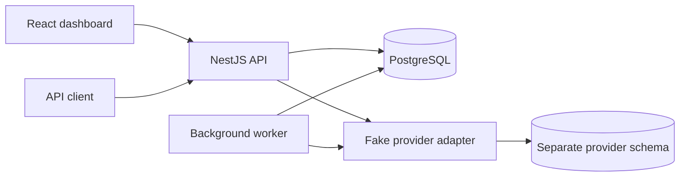
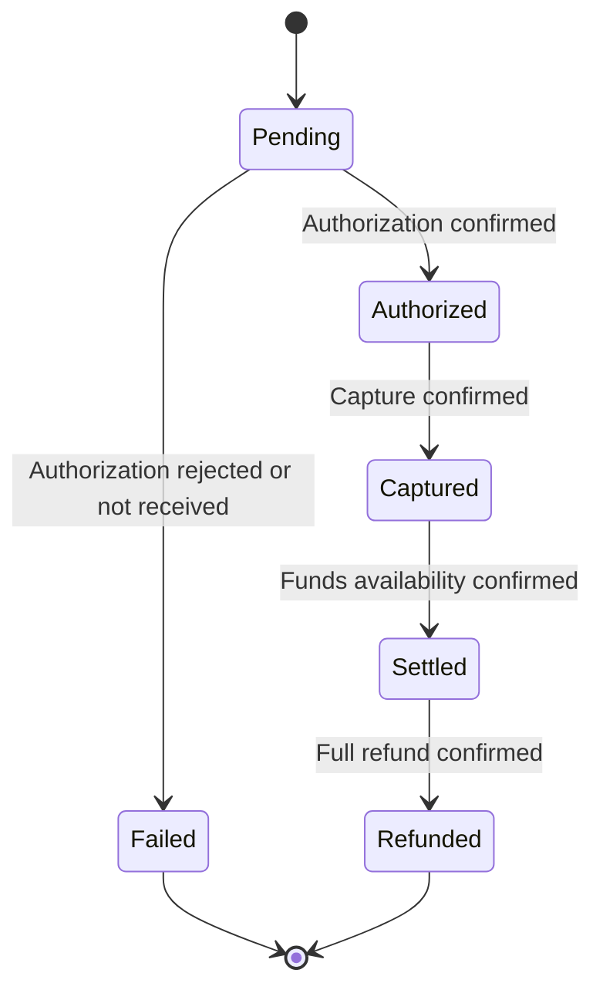

# Payment Processing Platform: Final Design

## 1. Scope

Build a small merchant payment platform with an authenticated API, a dashboard and a separate background worker. The source requirements are in `Software_Engineer-Technical_Exercise-Payment_Processing_Platform.md`.

A merchant logs in, creates and captures payments, watches them settle and requests full refunds after settlement. A fake provider, driven by test payment-method tokens, makes success, decline and uncertain outcomes reproducible without external keys.

**Included:** browser and API-client login/logout, payment creation/details/list/search, capture, full refund, settlement, recovery, audit and operation history, idempotency, logs, metrics and health checks.

**Deferred:** see §12, Future improvements.

This document describes the design. Once the application is built, `README.md` will hold setup commands, the implemented subset and actual test results.

## 2. Architecture and choices



The API and worker share payment services. Controllers handle HTTP, services enforce business rules, and repositories hold parameterized SQL. Provider calls run outside application database transactions.

| Choice | Reason and tradeoff |
|---|---|
| React, TypeScript, Vite and MUI | Suitable for forms, tables and details. Existing components reduce UI work; accessibility still needs checking. Server rendering is unnecessary for this dashboard. |
| Node.js, TypeScript and NestJS | One language and consistent modules for authentication, payments, provider and jobs. More framework setup than Express, but clearer conventions. |
| PostgreSQL with `pg` and SQL migrations | Transactions, constraints and locks keep payment changes consistent. Direct SQL makes those boundaries visible, at the cost of handwritten queries. |
| One PostgreSQL jobs table and a separate worker | No additional broker. Claim with `SELECT ... FOR UPDATE SKIP LOCKED`, poll every five seconds and implement bounded retry rules. Unlike a queue library, job recovery is our responsibility; keep it limited to this exercise. |
| JWT plus server-side session | Signed identity with explicit expiry and logout revocation. Browsers carry it in an HttpOnly cookie; API clients send it as a Bearer header. Every request still needs a session lookup; this is intentionally not stateless authentication. |
| Fake provider with test tokens | Predictable outcomes and restart tests. It does not demonstrate a real provider integration. |
| Pino, the Prometheus client (`@prometheus-io/client`, successor to `prom-client`) and trace-context propagation | Structured logs, metrics and a path to tracing. Exporter/backend deployment is optional. |

This document records decisions and tradeoffs. The exact contracts the code must match are in `project_spec.md`: component and package boundaries, sequence diagrams for each flow, request and response shapes, database DDL, provider contract, log events, metric names and configuration.

Organize code into `apps/api`, `apps/worker`, `apps/web`, and shared `packages/payments`, `packages/db`, `packages/provider`, `packages/observability`. Use Docker Compose for local API, worker, web and PostgreSQL services, and run builds and tests in containers too. The Node version is pinned to the current LTS in `.nvmrc` and the Dockerfiles, so the host's Node version does not matter.

### Project structure

```text
payment-processing/
├── Software_Engineer-Technical_Exercise-Payment_Processing_Platform.md
├── design_doc.md
├── project_spec.md              # Technical contracts: flows, API, schema, metrics
├── README.md
├── package.json                 # Workspace scripts and package definitions
├── package-lock.json
├── .nvmrc                       # Pinned Node LTS version
├── tsconfig.json                # Project references for `tsc -b`
├── eslint.config.mjs            # Strict, type-aware lint rules
├── jest.config.js               # Unit and integration test runner
├── .prettierrc
├── .prettierignore
├── tsconfig.base.json
├── compose.yaml                 # API, worker, web and PostgreSQL
├── .env.example
├── .gitignore
├── apps/
│   ├── api/
│   │   ├── package.json
│   │   ├── Dockerfile
│   │   └── src/
│   │       ├── main.ts
│   │       ├── app.ts           # Builds the Nest app (shared by main.ts and tests)
│   │       ├── app.module.ts
│   │       ├── tokens.ts        # Dependency-injection tokens
│   │       ├── config/          # Environment validation (spec §8)
│   │       ├── auth/            # Login, token issue, JWT/session checks, logout, CSRF, throttling
│   │       ├── payments/        # HTTP routes, request validation, OpenAPI, payment wiring
│   │       ├── seed/            # Development payments, created through the payment services
│   │       ├── cli/             # seed:payments entry point
│   │       ├── health/          # Liveness, readiness and metrics routes
│   │       └── common/          # Request IDs and consistent HTTP errors
│   ├── worker/
│   │   ├── package.json
│   │   ├── Dockerfile
│   │   └── src/
│   │       ├── main.ts          # Wiring, signals and shutdown
│   │       ├── config.ts        # Environment validation (spec §8)
│   │       ├── worker.ts        # Poll loop: claims free slots, runs jobs in their log/trace context
│   │       ├── heartbeat.ts     # Last poll-loop pass, for /health and a gauge
│   │       ├── handlers/        # Settlement and operation recovery
│   │       └── health.ts        # Worker health, readiness and metrics
│   └── web/
│       ├── package.json
│       ├── Dockerfile
│       ├── index.html
│       ├── vite.config.ts
│       └── src/
│           ├── main.tsx
│           ├── App.tsx
│           ├── pages/          # Login, payment list, create and details
│           ├── components/     # Forms, table, filters, status and history display
│           └── lib/            # API client, session state, pending actions
├── packages/
│   ├── payments/src/           # State rules, reservation and finalization
│   ├── db/
│   │   ├── src/                # Pool, transactions and SQL repositories
│   │   ├── migrations/         # Application and fake-provider schemas
│   │   └── seeds/              # Two development merchants (their payments: apps/api/src/seed)
│   ├── config/src/             # Environment reading shared by the API and the worker
│   ├── provider/src/           # Provider contract and durable fake adapter
│   └── observability/src/      # JSON logger, metrics and trace context
└── tests/
    ├── integration/            # API, PostgreSQL, provider and worker tests
    └── helpers/                # Isolated test database and scenario setup
```

Each shared package has its own `package.json` and TypeScript configuration; these are omitted from the tree for readability. Use npm workspaces and one root lockfile. Keep unit tests beside the state rules and utilities they test; keep cross-component tests in `tests/integration`.

The API and worker both call `packages/payments` for reservations, claims and finalization. HTTP handlers and worker handlers do not implement separate lifecycle rules. SQL lives in `packages/db`; provider calls go through `packages/provider`. The web app calls the API and never imports database or provider implementation code.

## 3. Payment lifecycle, money and payment methods



- USD only. Store integer cents; accept amounts from 1 to 100,000,000 cents as an exercise-specific limit. Validate integer arithmetic and trim reference to 1–100 characters.
- Full capture from Authorized; full refund from Settled. Other actions return 409 `INVALID_STATE_TRANSITION`.
- A rejected capture preserves Authorized; a rejected refund preserves Settled. Finish the rejected operation without creating a payment-state transition.
- A timeout preserves payment state and leaves the operation unresolved. Elapsed time alone never makes a payment Failed.
- If the provider reliably has no record of an authorization, the payment becomes Failed with reason `authorization_not_received`. It is never re-authorized later. Capture and refund may be re-sent with the same provider key, because the provider deduplicates them.
- Failed and Refunded are terminal. The fake provider does not expire authorization holds.
- Settlement means provider-confirmed funds availability, not a bank payout. Simulate availability ten seconds after capture; the worker must still confirm it.

Payment state describes a confirmed outcome. Operation status describes an action: `reserved`, `awaiting_confirmation`, `needs_review`, `succeeded` or `rejected`.

### Payment methods and card data

The platform never receives card numbers or CVVs. Customer checkout and tokenization belong to the provider and are out of scope. `POST /payments` takes a `paymentMethod` field holding a provider test token:

| Token | Fake provider behavior |
|---|---|
| `pm_card_visa` | Every call succeeds. |
| `pm_card_declined` | Authorization is declined; the payment is created in state Failed. |
| `pm_timeout` | The authorization never reaches the provider and the call times out. The API returns 202; recovery finds no record and marks the payment Failed (`authorization_not_received`). |
| `pm_lost_response` | The first call of each operation (authorize, capture, refund) takes effect, but its response is lost. The API returns 202; recovery confirms the outcome without a duplicate effect. |

Unknown tokens return 400. Request validation rejects unknown properties, so a field such as `cardNumber` is refused without being stored, echoed or logged. Store only the token, brand and last4; responses show brand and last4, and logs never include the token. Capture or refund rejections and timeouts before effect are injected in integration tests through the fake adapter's test interface, which is not reachable over HTTP.

## 4. Authentication and API

Hash passwords with Argon2id. A successful login issues an eight-hour signed JWT containing merchant ID, session ID and expiry. On every request, verify the configured signature algorithm, signature, issuer/audience and expiry, then check that the referenced server-side session is active and belongs to that merchant. Logout revokes the session.

**Browsers.** `POST /auth/login` sets the JWT in an HttpOnly, SameSite=Lax cookie. Local development uses HTTP with `Secure=false`; production requires HTTPS and `Secure=true`. A same-origin Vite proxy keeps browser requests simple: the dashboard calls the API under `/api` (prefix stripped by the proxy), so page paths such as `/payments/:id` remain dashboard routes when reloaded. Because the session cookie is HttpOnly, the dashboard learns who is signed in (and gets a fresh CSRF token) from `GET /auth/session` on every page load. Require a session-bound CSRF token on cookie-authenticated mutations, validate browser origins and protect login from cross-origin submission. A request that sends neither `Origin` nor `Referer` (typical of non-browser clients) is deliberately accepted by the origin check; on the cookie path it still needs the CSRF token.

**API clients.** `POST /auth/token` takes the same credentials, returns the JWT in the response body and sets no cookie. Clients send `Authorization: Bearer <JWT>`. Bearer requests get identical verification and skip the CSRF check: browsers do not attach this header automatically, and the API enables no cross-origin access. When an `Authorization` header is present it is the only credential considered, so the CSRF exemption never applies to a cookie-authenticated request.

Throttle failed attempts on both login endpoints in a PostgreSQL `login_attempts` table, keyed by normalized email and by client IP, so limits hold across API instances. The window length and both limits are configuration (`LOGIN_THROTTLE_WINDOW_SECONDS`, `LOGIN_THROTTLE_MAX_PER_EMAIL`, `LOGIN_THROTTLE_MAX_PER_IP`), defaulting to a fixed 15-minute window with 5 failures per email and 50 per IP. Each attempt is counted with one atomic increment before the password check, and refused if that pushes either count over its limit; a successful login clears the email's count and takes its own attempt back from the IP. Counting first means a burst of parallel guesses cannot all pass a read-then-record check before any failure is stored. Increments, resets and old-window cleanup each run in a short transaction that first takes a per-email, then a per-IP advisory lock, so they never lock rows in opposite orders and cannot deadlock. Tests use a short window so throttle tests cannot lock out the seeded merchants used by other tests. Return 429 with `Retry-After` and use generic credential errors.

Every payment, operation and audit query uses merchant identity from the verified session. Another merchant's resource returns 404. Seed two development merchants for isolation tests. Their development payments are not SQL seeds: a script creates them through the same payment services as the API, with fixed idempotency keys, so each has real provider, operation and audit records and a re-run replays instead of duplicating.

| Endpoint | Behavior |
|---|---|
| `POST /auth/login` | Validate credentials; set session cookie; return merchant, expiry and CSRF token |
| `POST /auth/token` | Validate credentials; return `{ accessToken, expiresAt }`; no cookie |
| `GET /auth/session` | Return merchant, expiry and a valid CSRF token after a page reload; no-store response |
| `POST /auth/logout` | Revoke session; clear cookie; 204 |
| `POST /payments` | `{ amount, reference, paymentMethod }` and `Idempotency-Key`; 201 for confirmed authorization or decline, 202 if unresolved |
| `GET /payments/{id}` | Payment, operation history (including rejected and paused actions), review flags and transition history |
| `GET /payments?status=&q=&cursor=&limit=` | Merchant-scoped status filter, reference substring search and cursor pagination |
| `POST /payments/{id}/capture` | Idempotency key; 200 success, 422 confirmed rejection, 202 unresolved |
| `POST /payments/{id}/refund` | Same response rules; allowed only from Settled |

**Why create and capture/refund differ on rejection.** Create returns 201 whenever the provider gives a definitive answer, including a decline: a payment resource now exists, in state Failed, with the decline reason. Capture and refund act on an existing payment, so a provider rejection returns 422 `PROVIDER_REJECTED` and the payment keeps its state. Replays return the original status.

List responses use `{ items, nextCursor }`, ordered by `(created_at DESC, id DESC)`. Default limit 25, maximum 100; validate cursors and bind them to merchant/filter values. Use UTC timestamps and include currency in money responses. Keep OpenAPI aligned with the code: the API serves a hand-written OpenAPI 3.1 document at `GET /openapi.json`, and tests fail if a route is undocumented (or documented but missing) or if a response does not match its schema.

Errors use `{ "error": { "code": "...", "message": "...", "requestId": "..." } }`, with an optional `details` object for field errors and provider rejections:

| HTTP | Code | When |
|---|---|---|
| 400 | `VALIDATION_ERROR` | Invalid body, query, cursor, idempotency key or payment-method token |
| 413 / 415 | `VALIDATION_ERROR` | Body too large, or an unsupported charset or `Content-Encoding` |
| 401 | `INVALID_CREDENTIALS` | Login or token request failed (generic message) |
| 401 | `UNAUTHENTICATED` | Missing, invalid, expired or revoked token |
| 403 | `CSRF_REJECTED` | Cookie-authenticated mutation without a valid CSRF token, or with an Origin/Referer that is not allowed |
| 404 | `NOT_FOUND` | Resource does not exist or belongs to another merchant |
| 409 | `INVALID_STATE_TRANSITION` | Action not allowed from the payment's current state |
| 409 | `OPERATION_IN_PROGRESS` | Another mutation on this payment is unresolved, including one paused for review |
| 409 | `IDEMPOTENCY_CONFLICT` | Same idempotency key reused with different input |
| 422 | `PROVIDER_REJECTED` | Provider rejected a capture or refund; payment state unchanged |
| 429 | `RATE_LIMITED` | Login throttle exceeded; includes `Retry-After` |
| 500 | `INTERNAL_ERROR` | Unexpected failure; no internal details exposed |
| 503 | `SERVICE_UNAVAILABLE` | Work cannot be durably accepted, for example the database is unreachable |

An unresolved response includes payment ID/state, operation ID/status, reason and `Location: /payments/{id}`. A paused operation still returns 202 on replay, with `needs_review` clearly indicating that automatic processing stopped.

## 5. Data and idempotency

| Table | Purpose |
|---|---|
| `merchants` | Identity and password hash |
| `sessions` | Merchant binding, client kind, expiry and revocation; the CSRF token is an HMAC of the session ID, so it is session-bound without being stored |
| `login_attempts` | Failed-attempt counters per email and per client IP, by time window |
| `payments` | Merchant, amount/currency, reference, payment-method token/brand/last4, state, failure reason, version, provider ID and timestamps |
| `operations` | Payment/action, client key, normalized request hash, provider key, expected payment version, status, reason, saved response and initiating request ID/trace context |
| `jobs` | Unique work identity, type, status, due time, retry count, lease owner/expiry/generation, review deadline, last error, request ID and trace context |
| `audit_events` | Payment, prior/new state, timestamp, actor, reason, operation and request IDs; unique transition identity |

Jobs carry the request ID and trace context of the request that created them. A settlement job inherits both from the capture that scheduled it, so one payment's journey can be followed from API request to settlement.

`payments.version` is used only for the compare-and-set check on finalize. Reservation saves the payment's current version on the operation (`expected_version`); finalization updates the payment `WHERE id = $1 AND version = $expected_version` and increments the version. Zero updated rows means the payment changed in a way the operation did not expect, so the transaction rolls back and re-reads. It is not exposed to clients.

Provider records live in a separate schema. Index payment list queries by merchant/time and merchant/state/time, add a `pg_trgm` GIN index on `payments.reference` for `ILIKE '%q%'` substring search, index jobs by status/due time, and audit by payment/time.

Require keys of 1–128 printable ASCII characters, excluding spaces, for create/capture/refund; UUIDs qualify. Uniqueness is `(merchant_id, action_scope, key)`, where scope is create or target payment plus action. Hash normalized, validated input so JSON property order is irrelevant.

- Same key/input: return the saved final status/body, or 202 while unresolved.
- Same key/different input: 409 `IDEMPOTENCY_CONFLICT`.
- Check merchant access and replay before rejecting an action based on current payment state. For capture and refund, these checks run inside the reservation transaction while holding the payment row lock (`SELECT ... FOR UPDATE`), so two concurrent requests cannot both see Authorized and both call the provider.
- Enforce one unresolved mutation per payment with a partial unique constraint covering reserved, awaiting confirmation and review statuses. A second mutation returns 409 `OPERATION_IN_PROGRESS`; paused work still blocks it.
- Retain idempotency records for the exercise. Saved responses describe the completed action; GET details returns current payment state.

## 6. Safe execution and recovery

1. In one short transaction, reserve the operation, its unique recovery job and the payment/creation audit when applicable. For capture and refund, lock the payment row first and recheck idempotency, unresolved operations and state under that lock. The API inserts the job already leased to itself, so the worker can take it over after lease expiry like any other claimed job. Commit before contacting the provider.
2. Call the provider with the saved provider key. The fake provider atomically deduplicates concurrent calls and durably stores the effect independently of the application transaction.
3. On a definitive result, lock payment, operation and job in that order, recheck job ownership, and update the payment's state and failure reason together with its compare-and-set version. Commit confirmed state, operation result, saved response, audit, job completion and any follow-up settlement job together. A rejected capture or refund finalizes the operation and job without updating the payment or writing an audit row.
4. On timeout, leave the operation awaiting confirmation, record the reason and schedule recovery. If the process crashes, the persisted job becomes available after lease expiry.
5. Recovery first looks up the saved provider key. Confirmed success or rejection finalizes locally. If the provider reliably has no record: for create, mark the payment Failed (`authorization_not_received`) and finalize the operation as rejected; for capture or refund, re-send with the same key. A lookup that could miss an existing effect is uncertain.

In the fake provider, lookup and mark-not-received are one atomic step. Authorize and lookup both write a single provider row keyed by the provider key. Lookup runs `INSERT ... (status 'not_received') ON CONFLICT (provider_key) DO NOTHING` and then reads the row. Authorize runs its own `INSERT ... ON CONFLICT DO NOTHING` and, if it finds a `not_received` row, returns rejected. The unique key serializes the two, so exactly one wins. A late-arriving original call therefore cannot authorize a payment already marked Failed. A real provider needs an equivalent guarantee (§11).

API and worker claim due jobs with `SELECT ... FOR UPDATE SKIP LOCKED` in a short transaction that sets the lease owner, a 30-second expiry and an increasing generation. A worker claims only as many jobs as it has free processing slots, one by default, so no claimed job waits locally while its lease runs down. The owner renews the lease before each provider call, and the lease must outlast a lookup plus a re-send. Every result or reschedule checks the current generation. An expired owner's late response cannot overwrite newer work. Provider deduplication still protects an overlapping call after lease takeover.

Every transaction that locks more than one of these rows acquires them in the order payment → operation → job, skipping rows it does not need. This applies to reservation, finalization, timeout rescheduling, pausing, settlement and resumption; job claims and lease renewals lock only the job. Never hold locks across provider calls. Settlement rechecks Captured state and unresolved mutations before committing Settled. Audit writes are atomic and deduplicated.

This covers crashes before reservation, before provider execution, after provider effect but before local commit, and after local commit but before the HTTP response. A durable job exists for every accepted mutation; unique work identities prevent duplicate job creation.

## 7. Worker and failure policy

One worker polls due jobs every five seconds for settlement and operation recovery. `SKIP LOCKED` claims mean additional worker instances cannot simultaneously own the same job. Process only due, unpaused work; expired running claims are recoverable.

| Setting | Decision |
|---|---|
| Provider timeout | Five seconds per call |
| Settlement availability in fake | Ten seconds after capture |
| Ordinary status check | Every five seconds |
| Worker concurrency | One job at a time; claim only free slots |
| Transient failures | One initial attempt plus up to three retries |
| Retry delay | Increasing delay with jitter, based on 2, 4 and 8 seconds |
| Reconciliation limit | Thirty minutes from initial acceptance; then pause for review |
| Heartbeat | Every ten seconds; stale after thirty seconds |
| Shutdown | Stop claiming; allow fifteen seconds to drain; recover unfinished work by lease expiry |

A recovery attempt is one claim of the job: the lookup plus any re-send the lookup requires. A technical failure anywhere in the attempt (timeout or provider unavailable) consumes one unit of the retry budget, even if the lookup inside it succeeded. The consecutive-failure count resets only when a whole attempt reaches a definitive outcome or an ordinary waiting outcome, such as the provider reporting work still in progress or settlement not yet available. Waiting outcomes use ordinary polling, bounded by the review deadline. So "not received, re-send, timeout" repeated over and over still stops after three retries.

Exhaustion or the review deadline pauses the job and records a reason. Uncertain mutation operations become `needs_review`; payment state remains unchanged. Paused settlement leaves Captured and exposes a settlement-review flag. Polling excludes paused jobs.

`needs_review` is our dead-letter state: work that automatic processing has given up on, kept in place with its reason and history until an operator resolves it. Paused settlement jobs, shown by the settlement-review flag, belong to the same state. There is no separate dead-letter queue.

Document database inspection and a guarded resumption procedure: verify provider outcome, lock the paused job, record operator/reason, preserve provider identity and history, reset its retry budget and set a new review deadline. Concurrent resumption accepts one update. Completed or invalidated work cannot be resumed. An operator CLI or replay screen is outside this slice.

## 8. Dashboard and observability

Provide login/logout, payment table, status/reference filters, pagination, creation with a test-token selector, and a details page showing the payment, its state-transition history and its operation history, so rejected and paused actions are visible. Enable capture only when Authorized and refund only when Settled, with no unresolved mutation. Include loading, empty, error and expired-session states; the backend enforces the same rules. Status, search and page size live in the page address, so a reload or a shared link keeps them. Changing any of them starts again at the newest page; older and newer pages keep the current rows on screen while the next page loads, and new filters show placeholders instead of the previous filters' rows. Because the address then carries what a merchant typed, an explicit sign-out sends the next sign-in to the plain list, and after an expired session sign-in returns to the same page only when the same merchant signs back in.

Generate one idempotency key per new action. Preserve pending action/key/input in merchant-scoped sessionStorage for page-reload and lost-response recovery. Retry with that key; never silently generate another key for an uncertain action. The record is saved before the first request and cleared only on a definite answer: a 200 or 201, a 400, 404 or 409 (nothing was reserved under the key), or a 422 (the provider's stored refusal). A 202, a network failure, a 401, 403 or 5xx keep it; after a 202 the action is sent once more with its key when the details show no unresolved operation, collecting the stored outcome. If the browser refuses to store the record, the action is not sent. A late answer updates the record only if the same key is still stored, so it cannot bring back a record cleared at sign-out or overwrite a newer one, and it never acts on a page that has been left. A create with an unknown outcome can only be sent again with its key; a new one can start once it has an answer. Capture and refund ask for confirmation. Load session/CSRF state before restoring pending work and clear browser records on explicit logout. The page-load session check treats only a 401 as signed out; a network or server failure shows that the server can't be reached, with a button to check again, so a valid session is never mistaken for a sign-out. Poll open unresolved details every five seconds (pending, captured and awaiting settlement, or with an unresolved operation, including one paused for review), pause polling while the page is hidden, and stop once only the merchant can move the payment; show review status when processing pauses. A payment that does not exist or belongs to another merchant shows as not found, matching the API's 404.

| Area | Instrumentation |
|---|---|
| Logs | Pino JSON with service, event, request/operation/job IDs, attempt and reason. Info for transitions, debug for routine polls/duplicates, warn for retries/review, error for exhausted work. |
| Correlation | Validate or generate request IDs, return them and persist them into operation and job context; settlement jobs inherit the capture's. Worker runs also have their own IDs. |
| API metrics | Request rate, errors and latency by method, route template and status class. |
| Payment metrics | Created/captured/refunded/failed transition counters and current-state counts. Durable audit is authoritative if an after-commit process counter misses an event. |
| Worker/provider metrics | Due queue depth, lag, retries, failures, paused backlog, heartbeat, provider timeouts and oldest unresolved age. A 202 response must not hide provider trouble. |
| Health | API `/health` for liveness and `/ready` for database/migration readiness. Worker heartbeat and its own readiness indicate background availability. |
| Audit | Who/what changed the payment, when, previous/new state and reason. Failed attempts belong in operation records, job records and logs, and appear in the details page's operation history. |
| Tracing | Preserve trace context across API, provider and jobs; document OpenTelemetry adoption. Verify propagation; a full tracing deployment is optional. |

Expose `/metrics` on API and worker. Keep labels bounded; no payment/merchant IDs or references. When scaling, emit global database gauges from one collector and distinguish per-process counters.

Do not accept real PAN/CVV or log raw bodies, passwords, cookies, tokens, payment-method tokens or secrets. Test redaction, including nested fields and serialized errors. Keep credentials out of source; provide `.env.example`. Operational examples should show request-to-worker correlation and inspection of delayed or paused work.

## 9. Testing strategy

**Unit tests** cover pure rules with small input spaces: the state-transition table, request-hash normalization, cursor encoding and validation, retry-delay calculation and log redaction. They are fast and can be exhaustive.

**Integration tests** (Jest and Supertest) run against real PostgreSQL and the durable fake provider. Correctness here depends on constraints, row locks, `SKIP LOCKED`, compare-and-set updates and transaction boundaries, which mocks would hide.

Automated tests use a separate, disposable PostgreSQL container started with `fsync`, `synchronous_commit` and `full_page_writes` off. This trades crash durability, which a throwaway test database does not need, for faster runs; locking, constraints and transaction semantics are unchanged. The development database keeps safe defaults, and production would never use these settings.

Integration scenarios:

- Each test token end to end, including `authorization_not_received` and a late original call rejected after it.
- Same-key replay, idempotency conflict, competing mutations (`OPERATION_IN_PROGRESS`) and invalid transitions.
- Capture/refund rejection returning 422 with state preserved; failed refunds.
- Timeout before effect and effect followed by a lost response; provider and application restarts.
- Stale-owner results after lease takeover; duplicate finalization and audit. Assertions count one audit row per transition: a successful create has two rows (creation to Pending, then Pending to Authorized), and recovery adds the authorization row exactly once.
- Retry exhaustion and review deadline; paused operations blocking new actions.
- Auth expiry, revocation, CSRF on the cookie path, Bearer access without CSRF, login throttling, and two-merchant isolation (404).
- Pagination and cursor binding; trigram reference search; readiness failure.
- Redaction and request-to-worker correlation in captured logs.

Two recovery scenarios are core and must pass: a provider effect that succeeds while the application dies before saving the result, followed by exactly one recovery; and a lease takeover where the old owner returns late without overwriting the new owner's result. The README will report which scenarios were run and their actual results.

## 10. Assumptions

- Payments are USD only, stored as integer cents from 1 to 100,000,000.
- Captures and refunds are for the full amount. Partial captures, partial refunds and cancellation are not supported.
- **Refunds are allowed only after settlement.** Real providers usually allow a refund once a payment is captured, sometimes as a reversal before settlement. Limiting refunds to Settled keeps one refund path and one state diagram for this exercise.
- Settlement means provider-confirmed funds availability, simulated ten seconds after capture. It is not a bank payout or a settlement batch.
- The platform receives only provider test tokens, never card data; customer checkout is out of scope.
- An authorization the provider never received fails the payment rather than being retried later, because re-authorizing long after the customer's request is a business decision this exercise does not make.
- Each merchant account has one user and no staff roles. Merchant references are not required to be unique; idempotency keys prevent duplicate creation.
- Authorization holds do not expire in the fake provider.
- The exercise runs locally over HTTP.
- Eight-hour sessions without refresh, the default login-throttle window and limits, five-second polling, three retries and the thirty-minute review threshold are exercise choices, not requirements imposed by the brief.

## 11. Production boundary

Before production: enable HTTPS/Secure cookies, managed secrets and restricted operational access; validate a real provider's idempotency, lookup, authorization expiry and refund semantics, including a guarantee that a "not received" authorization cannot later succeed (or a reversal path if it does); test backup/restore, migrations and failure recovery; define retention and operational runbooks; configure alerts from observed behavior; and load-test queries, claims, connection pools and worker concurrency.

Keep unresolved recovery data until resolved. Add replicas, a queue library or an external broker only when deployment or measured capacity needs justify them. Real payment collection, callbacks, disputes and broader accounting rules require separate design and integration tests.

## 12. Future improvements

- A real provider adapter (for example Stripe) behind the existing provider contract.
- Refunds from Captured, partial captures and refunds, authorization cancellation and multiple currencies.
- Outbound webhooks to merchants as a second background workflow.
- Merchant API keys for server-to-server access instead of password login for API clients.
- An operator CLI or screen for inspecting and resuming paused work.
- Staff roles and per-user audit actors within a merchant.
- A deployed OpenTelemetry collector and tracing backend, with dashboards and alerts.
- Any crash-point or resumption coverage beyond the two core recovery scenarios that is not completed in this slice, as listed in the README.
- Bounded worker concurrency above one job at a time, once measured load needs it.
