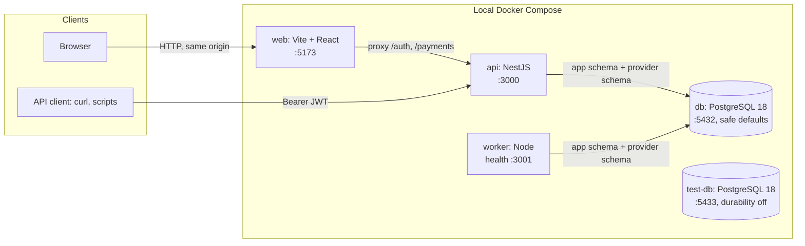
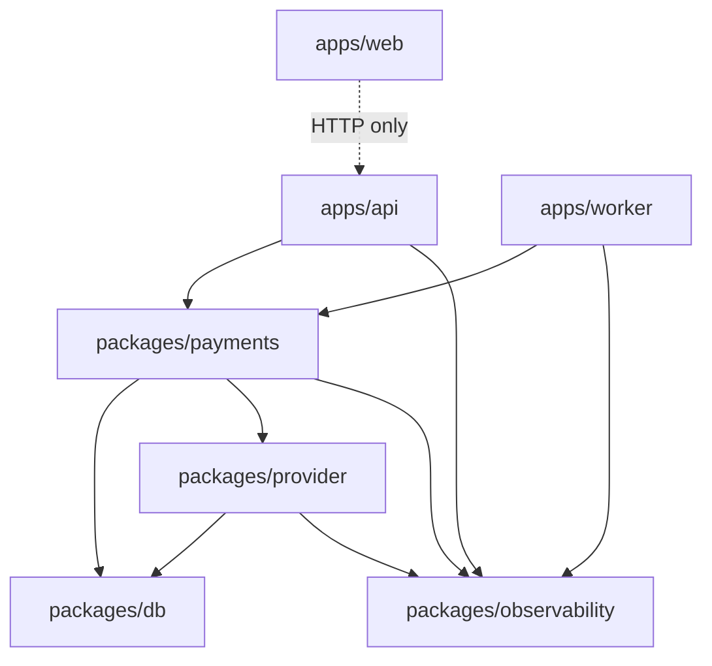
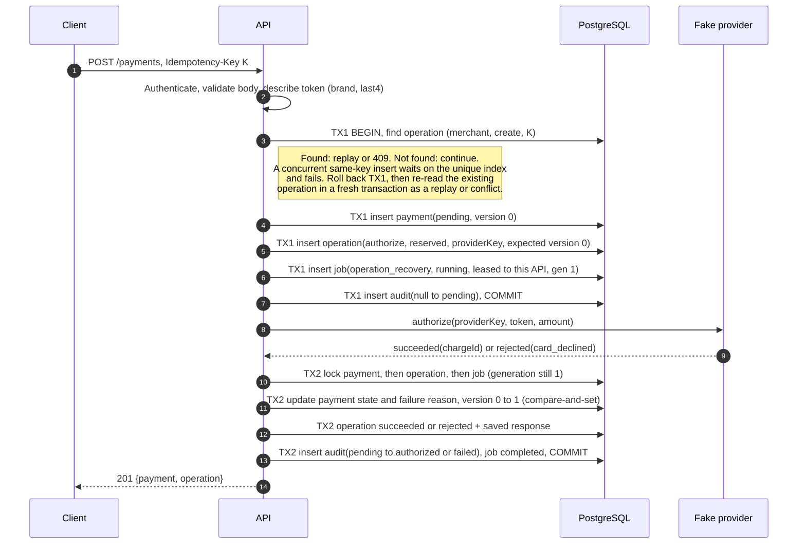
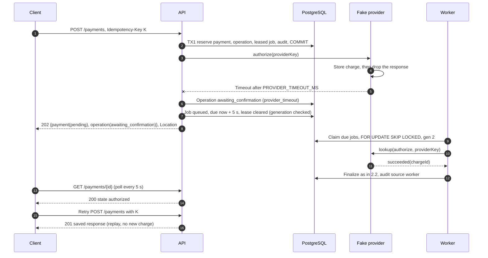
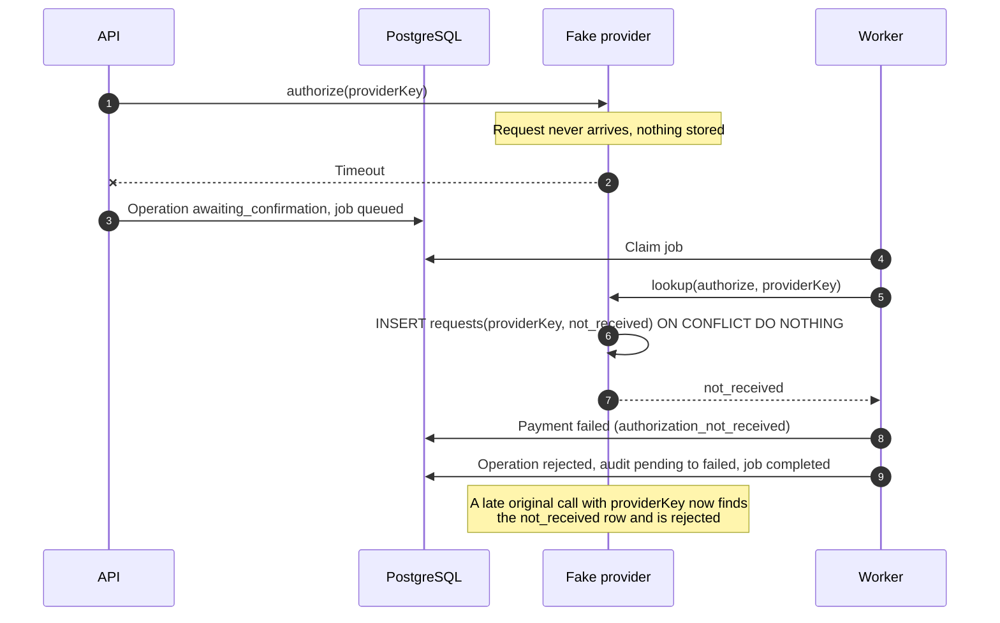
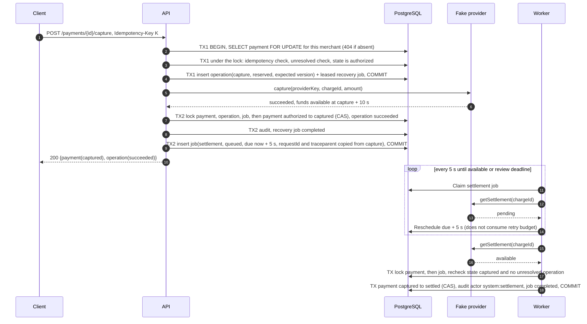
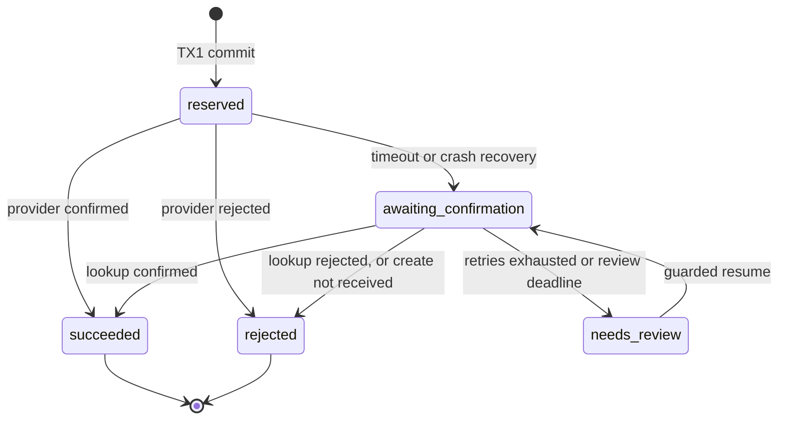
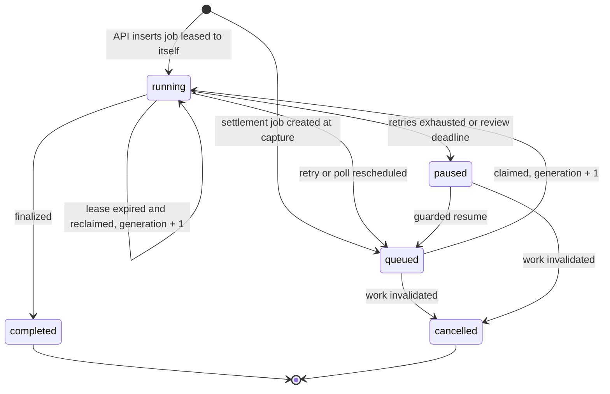
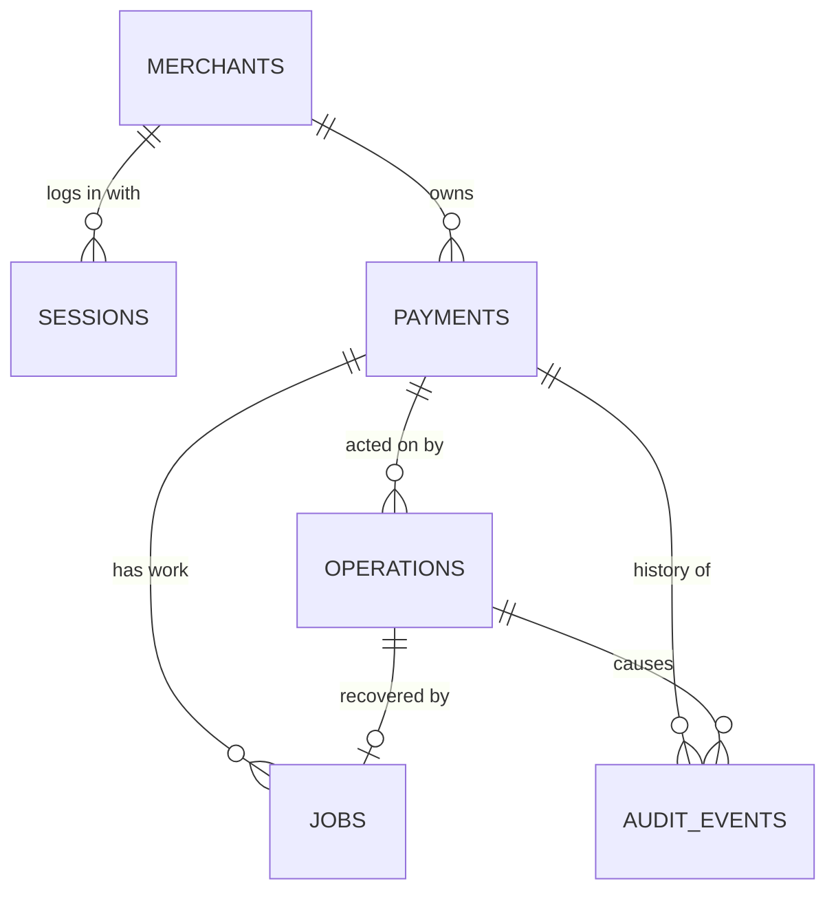

# Payment Processing Platform: Technical Specification

This specification defines the contracts the code must match: components, data flows, API, database schema, observability and configuration. `design_doc.md` explains why these choices were made and what was traded away. If the two disagree, fix the disagreement in the same change.

Diagrams use capitalized state names (Pending, Authorized) for readability. On the wire and in the database, states and statuses are lowercase snake_case (`pending`, `needs_review`).

## Contents

1. [System architecture](#1-system-architecture)
2. [Data flows](#2-data-flows)
3. [State machines](#3-state-machines)
4. [API design](#4-api-design)
5. [Database schema](#5-database-schema)
6. [Fake provider contract](#6-fake-provider-contract)
7. [Observability](#7-observability)
8. [Configuration](#8-configuration)
9. [Requirements traceability](#9-requirements-traceability)

## 1. System architecture

### 1.1 Runtime components



| Component | Responsibility | Does not |
|---|---|---|
| `web` | Login, payment list/search, create, details, capture/refund buttons, pending-action recovery | Touch the database or provider; decide lifecycle rules |
| `api` | Authentication, request validation, idempotency, reservation, synchronous provider call, finalization, read APIs, health and metrics | Run background polling |
| `worker` | Claim due jobs; operation recovery; settlement; heartbeat; queue and state gauges | Serve merchant traffic |
| `db` | Application schema (`public`) and fake-provider schema (`provider`) | — |
| `test-db` | Disposable database for automated tests only | Hold any data worth keeping |

The fake provider is a library (`packages/provider`) running inside the API and worker processes. It keeps its records in the `provider` schema and uses its own database transactions, never the application's, so its effects persist independently of application commits, as a real provider's would.

### 1.2 Package boundaries



| Package | Owns | Exposes |
|---|---|---|
| `packages/payments` | Transition table, idempotency rules, reservation, finalization, claim/lease rules, retry policy | `createPayment`, `capturePayment`, `refundPayment`, `recoverOperation`, `settlePayment`, `claimJobs` |
| `packages/db` | Pool, transaction helper, migration runner, SQL repositories | Repository functions taking a transaction client |
| `packages/provider` | Provider contract and the durable fake | `PaymentProvider` interface (§6) |
| `packages/observability` | Logger, redaction, request context, metrics registry, trace context | `logger`, `withContext`, `metrics`, `traceparent` helpers |

Rules: lifecycle decisions live only in `packages/payments`. Controllers and worker handlers translate HTTP or job input into calls on it. SQL appears only in `packages/db`. No package imports from `apps/*`.

### 1.3 Ports

| Service | Port | Purpose |
|---|---|---|
| web | 5173 | Dashboard (Vite dev server with proxy) |
| api | 3000 | Merchant API, `/health`, `/ready`, `/metrics` |
| worker | 3001 | `/health`, `/ready`, `/metrics` only |
| db | 5432 | Development database |
| test-db | 5433 | Automated tests |

Database host ports are defaults; `DB_HOST_PORT` and `TEST_DB_HOST_PORT` override them when another local PostgreSQL already uses them. Services always connect over the Compose network (`db:5432`, `test-db:5432`).

## 2. Data flows

### 2.1 Login and per-request authentication

```mermaid
sequenceDiagram
    autonumber
    participant B as Browser
    participant A as API
    participant DB as PostgreSQL
    B->>A: POST /auth/login {email, password}
    A->>A: Check Origin is allowed
    A->>DB: Count this attempt for email and IP (atomic upsert, RETURNING counts)
    A-->>B: 429 RATE_LIMITED + Retry-After if either count is over its limit
    A->>DB: Read merchant by lower(email)
    A->>A: Verify Argon2id hash
    alt credentials valid
        A->>DB: Clear the email's counters; take this attempt back from the IP
        A->>DB: Insert session (expires in 8 h)
        A->>A: Sign JWT {sub, sid, iat, exp, iss, aud}
        A-->>B: 200 {merchant, expiresAt, csrfToken} + Set-Cookie pp_session
    else invalid
        A-->>B: 401 INVALID_CREDENTIALS (the attempt stays counted)
    end
    Note over B,A: Later authenticated request
    B->>A: POST /payments + cookie + X-CSRF-Token
    A->>A: Verify JWT algorithm, signature, iss, aud, exp
    A->>DB: Session active, not revoked, belongs to sub
    A->>A: CSRF token matches session; Origin/Referer, if sent, is allowed
    A->>A: Continue with merchantId from session
```

API clients follow the same path through `POST /auth/token`, receive `accessToken` in the body, and send `Authorization: Bearer <JWT>`. Bearer requests skip the Origin and CSRF checks only.

### 2.2 Create payment: definitive result



### 2.3 Create payment: lost response (`pm_lost_response`)



### 2.4 Create payment: authorization not received (`pm_timeout`)



### 2.5 Capture and settlement



### 2.6 Refund

Same as capture (2.5, first half) with action `refund`, required state `settled`, final state `refunded`, and no follow-up job. A provider rejection returns 422 `PROVIDER_REJECTED`, finalizes the operation as `rejected` and leaves the payment `settled`.

### 2.7 Mutation decision order

Every create, capture and refund evaluates these checks in order. The first failure decides the response.

| # | Check | Failure |
|---|---|---|
| 1 | Authenticate (cookie or Bearer) | 401 `UNAUTHENTICATED` |
| 2 | Cookie path only: CSRF token valid, and Origin (or Referer) allowed when either is sent | 403 `CSRF_REJECTED` |
| 3 | `Idempotency-Key` present and valid; body valid; token known | 400 `VALIDATION_ERROR` |
| 4 | TX1 begins. Capture/refund: `SELECT ... FOR UPDATE` on the payment for this merchant | 404 `NOT_FOUND` |
| 5 | Operation with (merchant, scope, key) exists, same request hash | Replay saved response, or 202 with current status if unresolved |
| 6 | Same key, different request hash | 409 `IDEMPOTENCY_CONFLICT` |
| 7 | Another unresolved operation on this payment | 409 `OPERATION_IN_PROGRESS` |
| 8 | Action allowed from current state | 409 `INVALID_STATE_TRANSITION` |
| 9 | Insert operation (with the payment's current version as `expected_version`) and job, COMMIT TX1. Create only: a same-key unique violation aborts TX1, so ROLLBACK it, then re-read the existing operation in a fresh transaction and continue from step 5 (replay or conflict) | 503 `SERVICE_UNAVAILABLE` if the database cannot commit |
| 10 | Provider call, then finalize (TX2) or schedule recovery | 201/200, 422, or 202 |

Steps 4–9 run inside the reservation transaction. For capture and refund, the payment row lock means a concurrent action on the same payment waits until TX1 commits, then sees the new operation or state. Checking outside the transaction would let two requests both read `authorized` and both call the provider. Create has no payment row to lock yet; the unique idempotency index serializes same-key requests, and the new payment has no other actions.

The finalize compare-and-set protects the local update after a provider call. The reservation lock decides whether the provider call happens at all.

Responses from steps 1–4 and 6–8 are not stored as idempotent results, because no operation was reserved.

### 2.8 Correlation and trace propagation

| Hop | Request ID | Trace context |
|---|---|---|
| HTTP request in | Accept a valid `X-Request-Id`, otherwise generate one; echo it in the response | Accept a valid `traceparent`, otherwise start a new trace |
| Reservation (TX1) | Stored on `operations.request_id` and `jobs.request_id` | Stored on `operations.traceparent` and `jobs.traceparent` |
| Settlement job created at capture | Copied from the capture operation | Copied from the capture operation |
| Worker run | Logs both the job's original `requestId` and its own `workerRunId` | Continues the stored trace: same `traceId`, a new `spanId`, and the stored span logged as `followsFromSpanId` (the work runs later, so it follows from the request rather than nesting inside it) |
| Provider call | `requestId` in log fields | Child span of the current span |

Searching logs for one `requestId` shows the API request, the provider call, every worker attempt and the settlement.

## 3. State machines

### 3.1 Payment state

| From | Action / event | To | Actor |
|---|---|---|---|
| — | Create accepted | `pending` | `merchant:<id>` |
| `pending` | Authorization confirmed | `authorized` | `merchant:<id>` |
| `pending` | Authorization declined or not received | `failed` | `merchant:<id>` |
| `authorized` | Capture confirmed | `captured` | `merchant:<id>` |
| `captured` | Funds availability confirmed | `settled` | `system:settlement` |
| `settled` | Refund confirmed | `refunded` | `merchant:<id>` |

Every other (state, action) pair returns `INVALID_STATE_TRANSITION`. The audit `source` column records whether the API or the worker committed the transition; `actor` records who initiated it.

### 3.2 Operation status



`reserved`, `awaiting_confirmation` and `needs_review` are unresolved and block other mutations on the payment. `needs_review` is the dead-letter state.

### 3.3 Job status



### 3.4 Recovery attempts and the retry budget

A **recovery attempt** is one claim of a recovery job: the lookup plus any re-send that the lookup requires. The attempt, not each provider call inside it, decides the retry budget.

| Attempt ends with | `consecutive_failures` | Next step |
|---|---|---|
| Definitive outcome (confirmed success, rejection, or create not received) | — | Finalize; job completed |
| Ordinary waiting outcome (provider reports the work still in progress; settlement not yet available) | Reset to 0 | Reschedule after the poll interval |
| Technical failure in any call of the attempt (timeout, provider unavailable) | +1 | Retry after 2, 4, then 8 s with jitter; pause to `needs_review` when it would exceed `JOB_MAX_RETRIES` |

Details: the delay after the n-th consecutive failure is `JOB_RETRY_BASE_MS × 2^(n−1)`, within ±20% jitter. The review deadline is checked when an attempt starts; past it, the attempt pauses without calling the provider. The lease is renewed before the lookup and before any re-send, and a failed renewal ends the attempt without a call. Before the first write or provider call of an attempt, the stored job row is re-read: it must be an `operation_recovery` job naming the same operation and payment as the claimed record, and the operation must belong to that payment (and the payment to the operation's merchant). Every finalize, reschedule and pause transaction repeats the check under its locks before comparing the generation. A mismatch raises `WorkMismatchError` and changes nothing. A failed attempt marks the operation `awaiting_confirmation` with the failure as its reason; a pause marks it `needs_review` (`retries_exhausted` or `review_deadline_reached`) and the job `paused` with the same `paused_reason`. Every write checks the lease generation first.

Example: lookup succeeds with "not received", the capture is re-sent and times out. The attempt failed, so the count goes up by one even though the lookup itself succeeded. A later attempt that repeats the same pattern also counts as a failure, so at most three retries follow the initial attempt. The review deadline still pauses work that keeps waiting without failing.

## 4. API design

### 4.1 Conventions

- JSON over HTTP, UTF-8. Field names camelCase; enum values lowercase snake_case.
- IDs are UUID strings (UUIDv7, so they sort by creation time).
- Timestamps are ISO 8601 UTC with milliseconds, for example `2026-10-21T17:04:05.123Z`.
- Money is `amount` in integer cents plus `currency` (`"USD"`).
- Request bodies reject unknown properties with 400.
- No version prefix in this exercise; a `/v1` prefix would be added before external clients depend on the API.
- Auth and payment responses send `Cache-Control: no-store`.

| Request header | Used on | Rule |
|---|---|---|
| `Authorization: Bearer <JWT>` | Authenticated routes (API clients) | If present, it is the only credential considered |
| `Cookie: pp_session=<JWT>` | Authenticated routes (browser) | HttpOnly, SameSite=Lax, Path=/, Secure in production |
| `X-CSRF-Token` | Cookie-authenticated mutations | Must equal the session's CSRF token |
| `Idempotency-Key` | Create, capture, refund | Required; 1–128 printable ASCII characters, excluding spaces (`0x21`–`0x7E`); UUIDs qualify |
| `X-Request-Id` | Any | Optional; `^[A-Za-z0-9._:-]{1,64}$`, otherwise replaced |
| `traceparent` | Any | Optional; W3C format, otherwise ignored |

| Response header | When |
|---|---|
| `X-Request-Id` | Always |
| `Location: /payments/{id}` | 201 and 202 from payment mutations |
| `Retry-After` | 429, and 503 when known |

The CSRF token is `HMAC-SHA256(CSRF_SECRET, sessionId)`, so it is bound to the session, can be returned again after a page reload, and needs no storage.

Origin check (cookie-authenticated mutations, `/auth/login`, `/auth/token`): the `Origin` header, or the origin of `Referer` when `Origin` is absent, must be in `ALLOWED_ORIGINS`; an unparsable `Referer` is rejected. A request that sends neither header is deliberately accepted, because non-browser clients usually send neither and browsers send `Origin` on cross-origin POSTs. On the cookie path such a request still needs the correct CSRF token.

### 4.2 Resources

**Payment**

```json
{
  "id": "0192f0c4-7a1e-7c3b-9a8d-2f4b6c8e1a20",
  "state": "authorized",
  "amount": 1500,
  "currency": "USD",
  "reference": "order-1042",
  "paymentMethod": { "brand": "visa", "last4": "4242" },
  "failureReason": null,
  "settlementReview": false,
  "createdAt": "2026-10-21T17:04:05.123Z",
  "updatedAt": "2026-10-21T17:04:05.481Z"
}
```

`failureReason` is set only when `state` is `failed`: `card_declined` or `authorization_not_received`. The payment-method token is never returned.

**Operation**

```json
{
  "id": "0192f0c4-7a1f-7d10-8b55-6a1d3e9f0c42",
  "action": "capture",
  "status": "awaiting_confirmation",
  "reason": "provider_timeout",
  "createdAt": "2026-10-21T17:05:00.010Z",
  "completedAt": null
}
```

`action` is `authorize`, `capture` or `refund`. `reason` explains the latest status: `provider_timeout`, `provider_unavailable`, `capture_rejected`, `refund_rejected`, `card_declined`, `authorization_not_received`, `retries_exhausted` or `review_deadline_reached`.

**Transition** (from the audit trail)

```json
{
  "fromState": "authorized",
  "toState": "captured",
  "actor": "merchant:0192f0b1-0000-7000-8000-000000000001",
  "source": "api",
  "reason": "capture_confirmed",
  "requestId": "req-7f3a",
  "occurredAt": "2026-10-21T17:05:00.402Z"
}
```

**Error**

```json
{
  "error": {
    "code": "VALIDATION_ERROR",
    "message": "Request validation failed.",
    "requestId": "req-7f3a",
    "details": { "fields": [{ "field": "amount", "issue": "must be an integer from 1 to 100000000" }] }
  }
}
```

`details` is optional. It carries field errors for 400 as `fields: [{ field, issue }]` (the issue names the rule, never the value sent; an unknown field such as `cardNumber` reads `is not an accepted field`, and a bad `Idempotency-Key` is reported as that field), `{ state }` for 409 `INVALID_STATE_TRANSITION`, and `{ paymentId, operationId, code }` for 422. Every error response sends `Cache-Control: no-store`. A database that cannot be reached (connection refused or dropped, pool connect timeout, SQLSTATE class 08 or 57P01–57P03) answers 503 `SERVICE_UNAVAILABLE`. Codes and statuses are listed in design doc §4.

### 4.3 Authentication endpoints

**`POST /auth/login`**: browser login.

```json
{ "email": "merchant1@example.test", "password": "..." }
```

200, with `Set-Cookie: pp_session=...; HttpOnly; SameSite=Lax; Path=/; Max-Age=28800`:

```json
{
  "merchant": { "id": "0192f0b1-...", "name": "Acme Coffee", "email": "merchant1@example.test" },
  "expiresAt": "2026-10-22T01:04:05.000Z",
  "csrfToken": "c2Vzc2lvbi1ib3VuZA..."
}
```

Errors: 400, 401 `INVALID_CREDENTIALS`, 403 `CSRF_REJECTED` (Origin, or the Referer's origin when Origin is absent, is not in `ALLOWED_ORIGINS`), 429 `RATE_LIMITED`.

**`POST /auth/token`**: API-client login. Same request and errors. 200, no cookie:

```json
{ "accessToken": "eyJhbGciOiJIUzI1NiIs...", "tokenType": "Bearer", "expiresAt": "2026-10-22T01:04:05.000Z" }
```

**`GET /auth/session`**: 200 `{ merchant, expiresAt, csrfToken }`; `csrfToken` is `null` for Bearer sessions. 401 if not authenticated.

**`POST /auth/logout`**: revokes the session and clears the cookie. 204. Cookie-authenticated calls need the CSRF token.

JWT claims: `sub` (merchant ID), `sid` (session ID), `iat`, `exp`, `iss`, `aud`. Signed with HS256, because the API is the only issuer and verifier; verification rejects any other algorithm.

### 4.4 Payment endpoints

Mutations return `{ "payment": Payment, "operation": Operation }` for 200, 201 and 202, so clients handle one shape.

**`POST /payments`**

```json
{ "amount": 1500, "reference": "order-1042", "paymentMethod": "pm_card_visa" }
```

| Outcome | Status | Body |
|---|---|---|
| Authorized | 201 | payment `authorized`, operation `succeeded` |
| Declined | 201 | payment `failed` (`card_declined`), operation `rejected` |
| Unresolved | 202 | payment `pending`, operation `reserved`, `awaiting_confirmation` or `needs_review` |

Request hash input: `{ amount, reference (trimmed), paymentMethod }`, serialized with sorted keys.

**`POST /payments/{id}/capture`** and **`POST /payments/{id}/refund`**

Body is empty or `{}`; any field is a 400. Request hash input: `{ action, paymentId }`.

| Outcome | Status | Body |
|---|---|---|
| Confirmed | 200 | payment `captured` or `refunded`, operation `succeeded` |
| Provider rejected | 422 | Error `PROVIDER_REJECTED`, `details: { paymentId, operationId, code }`; state unchanged |
| Unresolved | 202 | Current payment, unresolved operation |

**`GET /payments/{id}`**

```json
{
  "payment": { "...": "Payment" },
  "pendingOperation": null,
  "operations": [ { "...": "Operation, oldest first, including rejected and paused" } ],
  "transitions": [ { "...": "Transition, oldest first" } ]
}
```

**`GET /payments`**

| Parameter | Rule |
|---|---|
| `status` | Optional; one payment state |
| `q` | Optional; 1–100 characters; case-insensitive substring of `reference` (`%` and `_` are escaped) |
| `limit` | Optional; 1–100, default 25 |
| `cursor` | Optional; opaque value from a previous `nextCursor` |

```json
{ "items": [ { "...": "Payment" } ], "nextCursor": "eyJ2IjoxLCJ0Ijoi..." }
```

Order: `created_at DESC, id DESC`. `nextCursor` is `null` on the last page. A cursor is `base64url(JSON {v, createdAt, id, filterHash})`, a `.`, and `base64url(HMAC-SHA256(CURSOR_SECRET, payload))`; `createdAt` has microseconds. `filterHash` is SHA-256 of `[merchantId, status, q]` (missing ones as `null`). The signature is checked first, in constant time. A tampered cursor, one used with different filters or by another merchant, or one longer than 512 characters returns 400 with `fields: [{ field: 'cursor', issue: 'is not valid for this query' }]`. Unknown query parameters return 400 like unknown body fields. A rule message shared by several broken rules is listed once.

### 4.5 Health and metrics

| Endpoint | Service | 200 when | Body |
|---|---|---|---|
| `GET /health` | API | Process is serving | `{ "status": "ok" }` |
| `GET /ready` | API | Database reachable and all migrations applied | `{ "status": "ready", "checks": { "database": "ok", "migrations": "ok" } }`; 503 with the failing check otherwise |
| `GET /health` | Worker | Poll loop heartbeat within 30 s (three heartbeat intervals) | `{ "status": "ok", "lastHeartbeatAt": "..." }`; 503 with `"status": "stale"` |
| `GET /ready` | Worker | Database reachable, migrations applied, not shutting down | The API's shape plus `"shuttingDown": false`; 503 once shutdown begins |
| `GET /metrics` | Both | Always | Prometheus text format |
| `GET /openapi.json` | API | Always | The OpenAPI 3.1 description of every API route |

Health, metrics and OpenAPI routes need no authentication. In production they would be reachable only from the internal network.

Each readiness phase (getting a connection, running the checks) is bounded, 2 s by default. The checks run on one connection inside a read-only transaction with `SET LOCAL statement_timeout`, so PostgreSQL itself cancels a blocked query. A connection that arrives after the limit is released at once, and a connection whose server stops answering is destroyed. Repeated probes during an outage therefore cannot exhaust the pool or delay shutdown.

## 5. Database schema

PostgreSQL 18. `uuidv7()` is built in from version 18. Enumerations use `text` with `CHECK` constraints, which are easier to change in a migration than PostgreSQL enum types.

Migrations are numbered SQL files in `packages/db/migrations`, applied in order, each in its own transaction, under a PostgreSQL advisory lock so concurrent starts cannot apply a file twice. The runner records each file in `schema_migrations (version, name, checksum, applied_at)` and refuses to run if an applied file has changed. Readiness compares that table with the files on disk.

### 5.1 Entity relationships



`login_attempts` stands alone. The `provider` schema has no foreign keys to the application schema; the link is the `provider_key` and `provider_payment_id` values, as with a real external provider.

### 5.2 Migration `001_auth.sql`

```sql
CREATE TABLE merchants (
  id            uuid PRIMARY KEY DEFAULT uuidv7(),
  email         text NOT NULL,
  name          text NOT NULL,
  password_hash text NOT NULL,                  -- Argon2id encoded string
  created_at    timestamptz NOT NULL DEFAULT now()
);
CREATE UNIQUE INDEX merchants_email_key ON merchants (lower(email));

CREATE TABLE sessions (
  id          uuid PRIMARY KEY DEFAULT uuidv7(),
  merchant_id uuid NOT NULL REFERENCES merchants (id),
  client_kind text NOT NULL CHECK (client_kind IN ('browser', 'api')),
  created_at  timestamptz NOT NULL DEFAULT now(),
  expires_at  timestamptz NOT NULL,
  revoked_at  timestamptz
);
CREATE INDEX sessions_merchant_idx ON sessions (merchant_id);

-- Fixed-window failure counters. subject_hash is SHA-256 of the normalized
-- email or client IP, so the table does not retain raw emails or addresses.
-- Every transaction that touches these rows first takes
-- pg_advisory_xact_lock(1001, hashtext(email hash)), then
-- pg_advisory_xact_lock(1002, hashtext(IP hash)), so increments, resets and
-- cleanup never lock in opposite orders.
CREATE TABLE login_attempts (
  scope        text NOT NULL CHECK (scope IN ('email', 'ip')),
  subject_hash text NOT NULL,
  window_start timestamptz NOT NULL,
  failures     integer NOT NULL DEFAULT 0,
  PRIMARY KEY (scope, subject_hash, window_start)
);
```

### 5.3 Migration `002_payments.sql`

```sql
CREATE EXTENSION IF NOT EXISTS pg_trgm;

CREATE TABLE payments (
  id                   uuid PRIMARY KEY DEFAULT uuidv7(),
  merchant_id          uuid NOT NULL REFERENCES merchants (id),
  amount_cents         bigint NOT NULL CHECK (amount_cents BETWEEN 1 AND 100000000),
  currency             char(3) NOT NULL DEFAULT 'USD' CHECK (currency = 'USD'),
  reference            text NOT NULL CHECK (char_length(reference) BETWEEN 1 AND 100),
  payment_method_token text NOT NULL,
  card_brand           text NOT NULL,
  card_last4           char(4) NOT NULL CHECK (card_last4 ~ '^[0-9]{4}$'),
  state                text NOT NULL CHECK (state IN
                         ('pending', 'authorized', 'captured', 'settled', 'failed', 'refunded')),
  failure_reason       text,
  provider_payment_id  text,
  settlement_review    boolean NOT NULL DEFAULT false,
  version              integer NOT NULL DEFAULT 0,   -- compare-and-set on finalize only
  created_at           timestamptz NOT NULL DEFAULT now(),
  updated_at           timestamptz NOT NULL DEFAULT now(),
  CHECK ((state = 'failed') = (failure_reason IS NOT NULL))
);
CREATE INDEX payments_merchant_created_idx
  ON payments (merchant_id, created_at DESC, id DESC);
CREATE INDEX payments_merchant_state_created_idx
  ON payments (merchant_id, state, created_at DESC, id DESC);
CREATE INDEX payments_reference_trgm_idx
  ON payments USING gin (reference gin_trgm_ops);
CREATE UNIQUE INDEX payments_provider_payment_id_key
  ON payments (provider_payment_id) WHERE provider_payment_id IS NOT NULL;

CREATE TABLE operations (
  id                uuid PRIMARY KEY DEFAULT uuidv7(),
  merchant_id       uuid NOT NULL REFERENCES merchants (id),
  payment_id        uuid NOT NULL REFERENCES payments (id),
  action            text NOT NULL CHECK (action IN ('authorize', 'capture', 'refund')),
  idempotency_scope text NOT NULL,     -- 'create', 'capture:<payment_id>' or 'refund:<payment_id>'
  idempotency_key   text NOT NULL CHECK (idempotency_key ~ '^[\x21-\x7E]{1,128}$'),
  request_hash      text NOT NULL,     -- SHA-256 hex of normalized input
  provider_key      text NOT NULL UNIQUE,
  expected_version  integer NOT NULL,  -- payments.version at reservation; finalize compares against it
  status            text NOT NULL CHECK (status IN
                      ('reserved', 'awaiting_confirmation', 'needs_review', 'succeeded', 'rejected')),
  reason            text,
  response_status   smallint,          -- saved final response, null while unresolved
  response_body     jsonb,
  request_id        text NOT NULL,
  traceparent       text,
  created_at        timestamptz NOT NULL DEFAULT now(),
  updated_at        timestamptz NOT NULL DEFAULT now(),
  completed_at      timestamptz,
  CHECK ((status IN ('succeeded', 'rejected')) = (completed_at IS NOT NULL))
);
CREATE UNIQUE INDEX operations_idempotency_key
  ON operations (merchant_id, idempotency_scope, idempotency_key);
CREATE UNIQUE INDEX operations_one_unresolved_per_payment
  ON operations (payment_id)
  WHERE status IN ('reserved', 'awaiting_confirmation', 'needs_review');
CREATE INDEX operations_payment_created_idx ON operations (payment_id, created_at);

CREATE TABLE jobs (
  id                   uuid PRIMARY KEY DEFAULT uuidv7(),
  type                 text NOT NULL CHECK (type IN ('operation_recovery', 'settlement')),
  work_key             text NOT NULL UNIQUE,   -- 'recover:<operation_id>' or 'settle:<payment_id>'
  payment_id           uuid NOT NULL REFERENCES payments (id),
  operation_id         uuid REFERENCES operations (id),
  status               text NOT NULL CHECK (status IN
                         ('queued', 'running', 'paused', 'completed', 'cancelled')),
  due_at               timestamptz NOT NULL,
  attempts             integer NOT NULL DEFAULT 0,
  consecutive_failures integer NOT NULL DEFAULT 0,
  lease_owner          text,
  lease_expires_at     timestamptz,
  lease_generation     bigint NOT NULL DEFAULT 0,
  review_deadline      timestamptz NOT NULL,
  paused_reason        text,
  last_error           text,
  request_id           text NOT NULL,
  traceparent          text,
  created_at           timestamptz NOT NULL DEFAULT now(),
  updated_at           timestamptz NOT NULL DEFAULT now(),
  completed_at         timestamptz,
  CHECK ((type = 'operation_recovery') = (operation_id IS NOT NULL)),
  CHECK ((status = 'running') = (lease_owner IS NOT NULL AND lease_expires_at IS NOT NULL))
);
CREATE INDEX jobs_queued_due_idx ON jobs (due_at) WHERE status = 'queued';
CREATE INDEX jobs_running_lease_idx ON jobs (lease_expires_at) WHERE status = 'running';
CREATE INDEX jobs_paused_idx ON jobs (type) WHERE status = 'paused';

CREATE TABLE audit_events (
  id           uuid PRIMARY KEY DEFAULT uuidv7(),
  payment_id   uuid NOT NULL REFERENCES payments (id),
  merchant_id  uuid NOT NULL REFERENCES merchants (id),
  from_state   text,                   -- null for creation
  to_state     text NOT NULL,
  actor        text NOT NULL,          -- 'merchant:<id>' or 'system:settlement'
  source       text NOT NULL CHECK (source IN ('api', 'worker')),
  reason       text NOT NULL,
  operation_id uuid REFERENCES operations (id),
  request_id   text NOT NULL,
  occurred_at  timestamptz NOT NULL DEFAULT now(),
  UNIQUE (payment_id, to_state)        -- each state is entered at most once
);
CREATE INDEX audit_events_payment_time_idx ON audit_events (payment_id, occurred_at);

CREATE FUNCTION audit_events_append_only() RETURNS trigger
LANGUAGE plpgsql AS $$
BEGIN
  RAISE EXCEPTION 'audit_events is append-only';
END;
$$;
CREATE TRIGGER audit_events_no_change
  BEFORE UPDATE OR DELETE ON audit_events
  FOR EACH ROW EXECUTE FUNCTION audit_events_append_only();
```

The lifecycle is linear, so each state is entered at most once per payment. `UNIQUE (payment_id, to_state)` therefore identifies a transition and makes duplicate finalization fail instead of writing a second audit row.

Tests assert **one audit row per transition**, not one row per payment. Expected totals for a payment's full history:

| Path | Audit rows, in order | Total |
|---|---|---|
| Create authorized (directly or through recovery) | null → `pending`, `pending` → `authorized` | 2 |
| Create declined or not received | null → `pending`, `pending` → `failed` | 2 |
| Authorized, then capture rejected | null → `pending`, `pending` → `authorized` | 2 |
| Full lifecycle | null → `pending`, → `authorized`, → `captured`, → `settled`, → `refunded` | 5 |

Recovery adds the missing transition exactly once. The creation row comes from reservation, so a recovered create must still total two rows, not three.

### 5.4 Migration `003_provider.sql`

```sql
CREATE SCHEMA provider;

CREATE TABLE provider.charges (
  id                 text PRIMARY KEY,          -- 'ch_' + random; returned as provider_payment_id
  token              text NOT NULL,
  amount_cents       bigint NOT NULL,
  status             text NOT NULL CHECK (status IN ('authorized', 'captured', 'refunded')),
  authorized_at      timestamptz NOT NULL DEFAULT now(),
  captured_at        timestamptz,
  funds_available_at timestamptz,               -- captured_at + SETTLEMENT_DELAY_MS
  refunded_at        timestamptz
);

-- One row per provider key. The primary key deduplicates concurrent calls and
-- serializes authorize against lookup-and-mark-not-received.
CREATE TABLE provider.requests (
  provider_key text PRIMARY KEY,
  kind         text NOT NULL CHECK (kind IN ('authorize', 'capture', 'refund')),
  charge_id    text REFERENCES provider.charges (id),
  outcome      text NOT NULL CHECK (outcome IN ('succeeded', 'declined', 'rejected', 'not_received')),
  code         text,
  created_at   timestamptz NOT NULL DEFAULT now()
);

-- Test-only fault injection; never written by HTTP handlers.
CREATE TABLE provider.injected_faults (
  id          bigserial PRIMARY KEY,
  kind        text NOT NULL CHECK (kind IN ('authorize', 'capture', 'refund')),
  charge_id   text,                             -- null matches any charge
  fault       text NOT NULL CHECK (fault IN ('timeout_before_effect', 'lost_response', 'reject')),
  consumed_at timestamptz
);
```

### 5.5 Key queries

**Lock order.** Every transaction that locks more than one of these rows acquires them in the order **payment → operation → job**, skipping rows it does not need. Transactions that lock a subset in the same order cannot deadlock with each other.

| Transaction | Rows locked, in order |
|---|---|
| Create reservation | New rows only: payment, operation, job. The idempotency unique index serializes same-key requests |
| Capture/refund reservation | Payment (`FOR UPDATE`), then insert operation and job |
| Finalize operation (success or rejection) | Payment → operation → job |
| Schedule recovery after a timeout or technical failure | Operation → job |
| Pause to `needs_review` | Payment (only to set `settlement_review`) → operation → job |
| Settlement finalize | Payment → job |
| Guarded resume | Payment → operation → job |
| Claim | Job only, with `SKIP LOCKED`, so it never waits |
| Lease renewal | Job only |

No transaction holds a lock while calling the provider.

**Settlement attempt.** One claim of a settlement job: check the stored job is the payment's `settlement` job (else `WorkMismatchError`, nothing written); past the review deadline, pause without asking the provider; renew the lease; ask `getSettlement`. `pending` reschedules after `WORKER_POLL_INTERVAL_MS` with `consecutive_failures` reset to 0 (an ordinary wait). `available` locks payment → job, rechecks the lease generation, then: if the payment is no longer `captured`, completes the job with no transition; if another operation on it is unresolved, waits like `pending`; otherwise `captured` → `settled` by compare-and-set on the current version, with an audit row (actor `system:settlement`, source `worker`, reason `settlement_confirmed`, no operation, the capture's request ID). A timeout or unreachable provider retries with the same backoff and budget as recovery. Retries exhausted or the deadline pause the job and set `payments.settlement_review`; the payment stays `captured`.

**Reservation values.** TX1 writes the operation with `provider_key = 'pk_' || <random UUID>` and `expected_version` set to the payment's current version (0 for a create). Its recovery job is inserted `running`, already leased: `lease_owner` is the reserving process, `lease_expires_at = now() + JOB_LEASE_SECONDS`, `lease_generation = 1`, `attempts = 0` (the claim query counts recovery attempts), `due_at = now()`, `review_deadline = now() + REVIEW_DEADLINE_SECONDS`, and the request's ID and `traceparent`. The creation audit row has reason `create_accepted`; transition rows use the confirming event (`authorization_confirmed`, `authorization_failed`, `capture_confirmed`, `settlement_confirmed`, `refund_confirmed`). An unknown payment-method token is refused before TX1 (400 `VALIDATION_ERROR`), and a payment ID that is not a UUID is treated as not found (404), like another merchant's payment. A valid ID is lowercased before the idempotency scope (`capture:<id>`, `refund:<id>`) and request hash are built, because PostgreSQL reads every spelling of a UUID as the same value. `operation.reserved` is logged after TX1 commits.

**Claim due jobs.** A worker claims only as many jobs as it has free processing slots (`WORKER_CONCURRENCY`, default 1), so a claimed job never waits in a local queue while its lease runs down:

```sql
WITH next AS (
  SELECT id AS next_id FROM jobs
  WHERE type = ANY($4)  -- only types this worker has handlers for
    AND ((status = 'queued'  AND due_at <= now())
      OR (status = 'running' AND lease_expires_at <= now()))
  ORDER BY due_at
  LIMIT $1          -- free slots, 1 by default
  FOR UPDATE SKIP LOCKED
)
UPDATE jobs j
SET status = 'running',
    lease_owner = $2,
    lease_expires_at = now() + make_interval(secs => $3),
    lease_generation = j.lease_generation + 1,
    attempts = j.attempts + 1,
    updated_at = now()
FROM next
WHERE j.id = next.next_id
RETURNING j.*;
```

The lease must outlast one full recovery attempt (a lookup plus a possible re-send, each up to `PROVIDER_TIMEOUT_MS`). The owner renews the lease before each provider call, and startup rejects configuration where `JOB_LEASE_SECONDS × 1000 ≤ 2 × PROVIDER_TIMEOUT_MS`.

**Finalize an operation.** One transaction, locks in the standard order. The SQL below is pseudocode: the numbered comments are not executable branches. The payment service chooses the statements to run from the provider outcome and the operation's action:

| Action | Provider outcome | Statements run | Payment change | Audit rows added |
|---|---|---|---|---|
| `authorize` | succeeded | 1, 2a, 3 | `pending` → `authorized`, set `provider_payment_id` | 1 |
| `authorize` | rejected (`card_declined`) or not received (`authorization_not_received`) | 1, 2a, 3 | `pending` → `failed`, set `failure_reason` | 1 |
| `capture` | succeeded | 1, 2a, 3, 4 | `authorized` → `captured` | 1 |
| `capture` | rejected | 1, 2b, 3 | none | 0 |
| `refund` | succeeded | 1, 2a, 3 | `settled` → `refunded` | 1 |
| `refund` | rejected | 1, 2b, 3 | none | 0 |

```sql
BEGIN;
-- 1. Lock in order: payment, operation, job
SELECT state, version FROM payments WHERE id = $payment FOR UPDATE;
SELECT status FROM operations WHERE id = $operation FOR UPDATE;
SELECT status, lease_generation FROM jobs WHERE id = $job FOR UPDATE;
-- Stop with ROLLBACK if lease_generation <> $gen (ownership lost: log
-- job.lease_lost), checked first, so a late answer from an expired owner is
-- always reported as such; otherwise if the operation is already resolved or
-- the job is not running (duplicate finalization by the current owner).

-- 2a. Outcome changes payment state: authorize succeeded, create declined or
--     not received, capture succeeded, refund succeeded.
UPDATE payments
SET state               = $to,
    failure_reason      = $failureReason,   -- 'card_declined' or 'authorization_not_received' when $to = 'failed', otherwise NULL
    provider_payment_id = coalesce($chargeId, provider_payment_id),
    version             = version + 1,
    updated_at          = now()
WHERE id = $payment AND version = $expectedVersion AND state = $from;
-- $expectedVersion is operations.expected_version. 0 rows: ROLLBACK and
-- re-read; the payment changed in a way this operation did not expect.
INSERT INTO audit_events
  (payment_id, merchant_id, from_state, to_state, actor, source, reason, operation_id, request_id)
VALUES ($payment, $merchant, $from, $to, $actor, $source, $auditReason, $operation, $requestId);

-- 2b. Capture or refund rejected by the provider: no payments update and no
--     audit row. Only verify that the locked payment still has
--     state = $from and version = $expectedVersion; otherwise ROLLBACK.

-- 3. Both paths: resolve the operation and complete its job.
UPDATE operations
SET status = $status, reason = $reason, response_status = $httpStatus,
    response_body = $body, completed_at = now(), updated_at = now()
WHERE id = $operation;
UPDATE jobs
SET status = 'completed', lease_owner = NULL, lease_expires_at = NULL,
    completed_at = now(), updated_at = now()
WHERE id = $job;

-- 4. Capture succeeded only: schedule settlement, inheriting correlation.
INSERT INTO jobs (type, work_key, payment_id, status, due_at, review_deadline, request_id, traceparent)
VALUES ('settlement', 'settle:' || $payment, $payment, 'queued',
        $dueAt, $reviewDeadline, $requestId, $traceparent)   -- poll interval and review deadline from configuration
ON CONFLICT (work_key) DO NOTHING;
COMMIT;
```

**What finalization stores.** The saved response is what a replay returns. For 200 and 201 it is `{ payment, operation }` as of the commit. For a rejected capture or refund it is `{ error: { code: 'PROVIDER_REJECTED', message, details: { paymentId, operationId, code } } }` without a `requestId`; the API adds the current request's ID when it sends the envelope. A failed create stores the provider's code as `failure_reason` (`card_declined`, or `authorization_not_received` when the provider has no record). The audit row's `request_id` is the operation's, so the API and the worker record the same initiating request. When finalization stops early (operation already resolved, lease lost, version or state changed) it has written nothing, so it ends the transaction without changes.

The `failure_reason` check constraint means state and reason must change together, which path 2a does. A rejected capture or refund resolves its operation without touching the payment, so no transition is invented.

**List payments** (search with `q`, next page with cursor):

```sql
SELECT <payment columns>,
       to_char(created_at AT TIME ZONE 'UTC', 'YYYY-MM-DD"T"HH24:MI:SS.US"Z"') AS cursor_created_at
FROM payments
WHERE merchant_id = $1
  AND ($2::text IS NULL OR state = $2)
  AND ($3::text IS NULL OR reference ILIKE $3 ESCAPE '\')   -- $3 = '%' || escaped q || '%'
  AND ($4::timestamptz IS NULL OR (created_at, id) < ($4::timestamptz, $5::uuid))
ORDER BY created_at DESC, id DESC
LIMIT $6;   -- the page size + 1: one extra row tells whether nextCursor is needed
```

`q` has `\`, `%` and `_` escaped with a backslash before it is wrapped in `%`, so they match themselves. The cursor carries `created_at` to the microsecond (`cursor_created_at`), because a JavaScript `Date` keeps only milliseconds and a rounded key would skip or repeat rows created within one millisecond. The query text is exported as `LIST_PAYMENTS_SQL`, and a test runs `EXPLAIN` on it.

The trigram index helps when `q` has 3 or more characters; shorter searches fall back to the merchant index.

## 6. Fake provider contract

```ts
export interface PaymentProvider {
  describePaymentMethod(token: string): { brand: string; last4: string } | null;
  authorize(req: { providerKey: string; token: string; amountCents: number }): Promise<ProviderResult>;
  capture(req: { providerKey: string; chargeId: string; amountCents: number }): Promise<ProviderResult>;
  refund(req: { providerKey: string; chargeId: string; amountCents: number }): Promise<ProviderResult>;
  lookup(req: { kind: 'authorize' | 'capture' | 'refund'; providerKey: string }): Promise<LookupResult>;
  getSettlement(chargeId: string): Promise<{ status: 'pending' | 'available' }>;
}

export type ProviderResult =
  | { outcome: 'succeeded'; chargeId: string }
  | { outcome: 'rejected'; code: string };

export type LookupResult = ProviderResult | { outcome: 'not_received' };

// Timeouts throw ProviderTimeoutError; other transport failures throw
// ProviderUnavailableError. Callers treat both as "outcome unknown".
```

| Token | Brand / last4 | Authorize | Capture / refund |
|---|---|---|---|
| `pm_card_visa` | visa / 4242 | Succeeds | Succeed |
| `pm_card_declined` | visa / 0002 | Rejected `card_declined` | Not reachable (payment is Failed) |
| `pm_timeout` | mastercard / 4444 | Nothing stored, times out | Not reachable (payment ends Failed) |
| `pm_lost_response` | amex / 0005 | First call stores the effect, then times out | First call per operation stores the effect, then times out |

Behavior rules:

- Every call with an existing `provider_key` returns the stored outcome without a new effect.
- `lookup('authorize')` runs `INSERT INTO provider.requests (provider_key, kind, outcome) VALUES ($1, 'authorize', 'not_received') ON CONFLICT (provider_key) DO NOTHING`, then reads the row, in one transaction. An `authorize` that later finds a `not_received` row returns `rejected` with code `authorization_not_received`.
- `lookup('capture' | 'refund')` only reads. An absent row returns `not_received`, and recovery re-sends with the same key.
- A timeout waits `PROVIDER_TIMEOUT_MS` before throwing, so client timing is realistic. Tests set a short value.
- `getSettlement` returns `available` once `now() >= funds_available_at`.
- Before applying a call, the fake consumes the oldest matching unconsumed row in `provider.injected_faults`, if any. Only integration tests write that table.
- Faults apply only to `authorize`, `capture` and `refund` calls of the matching `kind` (a row with no `charge_id` matches any charge; authorize has no charge yet, so only those match), never to `lookup` or `getSettlement`. A call whose key already has a stored outcome returns it without consuming a fault. `timeout_before_effect` stores nothing and times out; `lost_response` stores the effect, then times out; `reject` stores `rejected` with code `rejected_by_provider`.
- Capture and refund lock the charge row, so of several calls with different keys on one charge only one takes effect; the others are rejected. Both are for the full authorized amount.
- Rejection codes: `card_declined` and `unknown_payment_method` (authorize, stored as `declined`), `authorization_not_received`, `charge_not_found`, `charge_not_capturable`, `charge_not_refundable`, `amount_mismatch`, `rejected_by_provider`.
- A failure of the fake's own storage, including `getSettlement` for an unknown charge, throws `ProviderUnavailableError`.
- The fake's SQL lives in `packages/db` (`repositories/provider.ts`); `packages/provider` holds the contract, the test tokens and the fake's decisions.

## 7. Observability

### 7.1 Log events

Every line is JSON with `time`, `level`, `service` (`api` or `worker`), `event`, `requestId`, and, when known, `traceId`, `spanId`, `paymentId`, `operationId`, `jobId`, `workerRunId`, `attempt`, `reason` and `durationMs`.

| Event | Level | Emitted when |
|---|---|---|
| `http.request.completed` | info (warn for 4xx except 401/404, error for 5xx); `/health`, `/ready`, `/metrics` at debug, or warn when they return 5xx | Every request, with method, route template, status and duration |
| `auth.login.succeeded` / `auth.login.failed` | info / warn | Login or token request |
| `auth.logout` | info | Session revoked |
| `auth.rejected` | debug | Request without a valid credential (reason: missing, malformed header, invalid, expired, session not active) |
| `auth.throttled` | warn | 429 returned (scope: `email` or `ip`, `retryAfter`) |
| `auth.csrf_rejected` | warn | 403 `CSRF_REJECTED` (reason: `csrf_token_invalid`, `origin_not_allowed`, `login_origin_not_allowed`) |
| `operation.reserved` | info | TX1 committed |
| `provider.call.completed` | debug (warn on timeout) | Each provider call, with operation and outcome |
| `payment.transitioned` | info | A state transition committed |
| `operation.awaiting_confirmation` | warn | Timeout or unavailable provider |
| `idempotency.replayed` / `idempotency.conflict` | debug / warn | Replay or conflict |
| `job.claimed` / `job.poll_rescheduled` | debug | Routine worker activity |
| `job.retry_scheduled` | warn | Technical failure consumed retry budget |
| `job.lease_lost` | warn | Generation check failed at finalize or when rescheduling |
| `operation.version_conflict` | warn | Finalize found the payment at a different version or state than the operation expected; nothing written |
| `operation.already_final` | debug | Finalize found the operation already resolved; nothing written |
| `job.paused` | error | Retries exhausted or review deadline: work moved to `needs_review` |
| `db.pool.idle_client_error` | warn | An idle database connection dropped; logged outside any request context |

Redaction is by key name at any depth, including inside serialized errors and their causes, with the value replaced by `[REDACTED]`. Keys are compared case-insensitively with `-` and `_` ignored: `password`, `passwordHash`, `authorization`, `cookie`, `set-cookie`, `accessToken`, `refreshToken`, `csrfToken`, `idToken`, `jwt`, `paymentMethod`, `payment_method_token`, `cardNumber`, `pan`, `cvv`, `cvc`, `secret`, and any key ending in `password`, `secret` or `token`. Pino's fixed-path `redact` option cannot match keys at arbitrary depth, so redaction runs in the logger's `log` formatter on a copy of the fields. Fields bound with `child()` or `setBindings()` bypass that formatter in pino, so the logger redacts them as they are bound. Request and response bodies are never logged.

### 7.2 Metrics

| Metric | Type | Labels | Emitted by |
|---|---|---|---|
| `http_requests_total` | counter | `method`, `route`, `status_class` | API, worker health server |
| `http_request_duration_seconds` | histogram | `method`, `route`, `status_class` | API |
| `payment_transitions_total` | counter | `from_state`, `to_state` | Process that committed |
| `payments_by_state` | gauge | `state` | Worker collector only |
| `idempotency_replays_total` | counter | `action` | API |
| `idempotency_conflicts_total` | counter | `action` | API |
| `provider_requests_total` | counter | `operation`, `outcome` (`succeeded`, `rejected`, `timeout`, `unavailable`) | API, worker |
| `provider_request_duration_seconds` | histogram | `operation` | API, worker |
| `jobs_due` | gauge | `type` | Worker collector (queue depth) |
| `jobs_lag_seconds` | gauge | `type` | Worker collector (age of the oldest due job) |
| `jobs_paused` | gauge | `type` | Worker collector (dead-letter backlog) |
| `job_runs_total` | counter | `type`, `result` (`completed`, `rescheduled`, `retried`, `paused`, `lease_lost`) | Worker, API |
| `operations_unresolved_oldest_age_seconds` | gauge | — | Worker collector |
| `worker_heartbeat_timestamp_seconds` | gauge | — | Worker |

Labels never contain payment IDs, merchant IDs or references. Database-wide gauges are computed by a single collector in the worker, so running several API instances does not double-count them.

## 8. Configuration

All settings come from environment variables, validated at startup; the process exits with a clear error if one is missing or invalid. `.env.example` lists them with development values.

| Variable | Default | Used by |
|---|---|---|
| `DATABASE_URL` | — (required) | API, worker, migrations |
| `TEST_DATABASE_URL` | — (required in tests) | Test runner |
| `API_PORT` | `3000` | API |
| `WORKER_HEALTH_PORT` | `3001` | Worker |
| `JWT_SECRET` | — (required, at least 32 bytes) | API |
| `JWT_ISSUER` / `JWT_AUDIENCE` | `payment-platform` / `payment-platform-api` | API |
| `SESSION_TTL_SECONDS` | `28800` | API |
| `CSRF_SECRET` | — (required) | API |
| `CURSOR_SECRET` | — (required) | API |
| `COOKIE_SECURE` | `false` (must be `true` in production) | API |
| `ALLOWED_ORIGINS` | `http://localhost:5173` | API |
| `TRUST_PROXY` | `false` | API (client IP for throttling) |
| `LOGIN_THROTTLE_WINDOW_SECONDS` | `900` | API |
| `LOGIN_THROTTLE_MAX_PER_EMAIL` | `5` | API |
| `LOGIN_THROTTLE_MAX_PER_IP` | `50` | API |
| `PROVIDER_TIMEOUT_MS` | `5000` | API, worker |
| `SETTLEMENT_DELAY_MS` | `10000` | Fake provider |
| `WORKER_POLL_INTERVAL_MS` | `5000` | Worker; API (delay of the first recovery after a timeout and of the first settlement check) |
| `WORKER_CONCURRENCY` | `1` | Worker (jobs claimed only for free slots) |
| `JOB_LEASE_SECONDS` | `30` | API, worker (must exceed two provider timeouts) |
| `JOB_MAX_RETRIES` | `3` | API, worker |
| `JOB_RETRY_BASE_MS` | `2000` | API, worker (2, 4, 8 s with jitter) |
| `REVIEW_DEADLINE_SECONDS` | `1800` | API, worker |
| `WORKER_HEARTBEAT_INTERVAL_MS` | `10000` | Worker |
| `WORKER_SHUTDOWN_GRACE_MS` | `15000` | Worker |
| `LOG_LEVEL` | `info` | All |

## 9. Requirements traceability

| Brief requirement | Where it is met |
|---|---|
| Login; token validation and expiry | Spec §2.1, §4.3; design §4 |
| Create, get, capture, refund, list/search | Spec §4.4; design §4 |
| Lifecycle states | Spec §3.1; design §3 |
| Asynchronous workflow | Spec §2.3–2.5, §3.3; design §6–7 |
| Dashboard | Design §8 |
| Structured logs, correlation, levels, no sensitive data | Spec §2.8, §7.1; design §8 |
| RED, business and queue metrics | Spec §7.2; design §8 |
| Tracing | Spec §2.8; design §8 |
| Health/readiness | Spec §4.5 |
| Audit trail | Spec §5.3 (`audit_events`), §4.2 (Transition); design §8 |
| Consistent errors | Spec §4.2; design §4 error table |
| Idempotency | Spec §2.7, §5.3; design §5 |
| Retries, timeouts, dead-letter | Spec §3.2–3.3, §6; design §7 |
| Documentation deliverables | README; design §10–12 |
